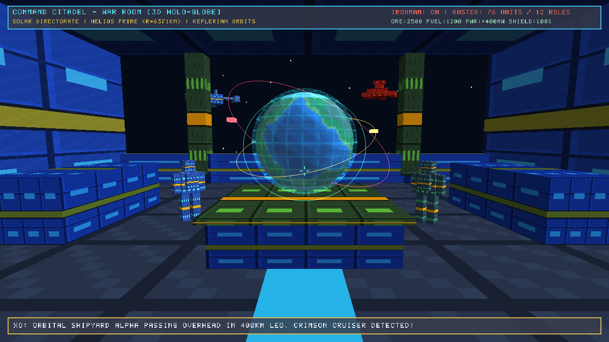
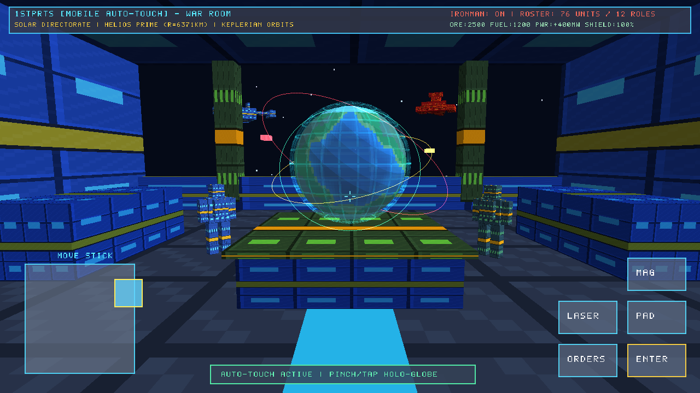

# 1stPRTS (`1prtsg`)

> **Command a planetary-to-orbital empire from the boots up — with one life on the line.**  
> An exclusively first-person Real-Time Strategy (RTS) game set in a classic bold-color retro space-opera universe on **true-scale spherical planets with real orbital mechanics**, where all **76 enterable constructs** (buildings, ground vehicles, naval ships, aircraft, spacecraft, and space stations) are realistically huge, manned by **12 crew roles**, and fully explorable.

---

## Live Engine Screenshots (SDL3 + OpenGL 3.3 Core)

| War Room 3D Planetary & Orbital Holo-Globe | Planetary Surface 1:1 Scale & Shield Dome |
| :---: | :---: |
|  |  |

| Dropship Walkable Troop Bay (Orbital Ascent) | 400km Orbital Shipyard & Dreadnought Battle |
| :---: | :---: |
|  |  |

| Mobile Web Auto-Touch Virtual Controls |
| :---: |
|  |

---

## Core Architecture & Features Implemented (Phase 1)

- **Exclusively First-Person Commander (Hardcore Ironman):** No god-camera. Command armies and orbital fleets through diegetic physical consoles and glowing **3D Planetary & Orbital Holo-Globes**. Commander death ends the match unless you physically eject via an **Escape Pod**.
- **True-Scale Spherical Planet & Keplerian Orbital Mechanics (`src/planet.c`):** 64-bit double-precision geocentric coordinates, 6-face cube-sphere planetary surface, East-North-Up (ENU) local surface frames, exponential atmosphere & re-entry heat model, Velocity-Verlet orbital propagation, Keplerian element solver, and Hohmann transfer delta-v solver.
- **Doubled External Roster (`docs/ROSTER.md`, `scripts/units/`, `scripts/crew/`):** **76 distinct enterable constructs** (24 Buildings · 10 Ground Vehicles · 10 Naval Ships · 8 Aircraft · 14 Spacecraft · 10 Space Stations) + **12 crew/personnel roles** registered dynamically from external MIT Lua 5.4 scripts.
- **Zero Baked Assets & Layered Mod VFS (`src/vfs.c`):** All models, textures, 8-directional sprites, optional voxels, GLSL shaders, audio, planet configs, and Lua scripts live in plain external directories (`assets/`, `scripts/`, `mods/`, `config/`) beside the binary (and load as loose HTTP files via `manifest.json` on Emscripten Web). Includes a working sample mod at [`mods/example_mod/`](mods/example_mod/mod.json).
- **Retro Space-Opera 3D Renderer (`src/retro_renderer.c`, `src/gfx_gl.c`, `src/gfx_null.c`):** Unified OpenGL 3.3 Core / OpenGL ES 3.0 / WebGL 2.0 pipeline combining low-poly `.obj` 3D meshes, `GL_NEAREST` pixel textures, hybrid 3D/8-dir sprite crew LOD, optional face-culled chunked voxels (`src/voxel.c`), Fresnel energy shield domes, plasma beams, and bitmap HUD / Auto-Touch overlay.
- **Cross-Platform Targets:** CMake presets for **Linux**, **Windows (MSVC)**, **macOS (Universal)**, and **Web / Mobile Auto-Touch / WebXR (Emscripten)** ([`web/index.html`](web/index.html), [`web/xr_bridge.js`](web/xr_bridge.js)).

---

## Quick Build, Test & Coverage Verification

### Prerequisites
- C11 compiler (`gcc`, `clang`, or MSVC), CMake >= 3.24, Ninja (or Make), OpenGL development headers, Python 3.
- Dependencies (**SDL3**, **Lua 5.4**, **Unity**, **stb**) are fetched automatically by CMake `FetchContent` (all permissive licenses — see [`THIRD_PARTY_NOTICES.md`](THIRD_PARTY_NOTICES.md)).

### Build & Run All Tests + >= 95% Coverage Gates (Linux)

```bash
# Configure & build with coverage instrumentation
cmake --preset linux-coverage
cmake --build --preset linux-coverage -j$(nproc)

# Run C Unity unit tests, Lua unit tests (>= 95% Lua coverage), and 8 headless automated game tests
ctest --preset linux-coverage --output-on-failure

# Verify >= 95% C11 core engine line coverage
python3 tools/check_coverage.py --build-dir build/linux-coverage --source-root . --min-line 95.0
```

### Run Interactively or Capture Live OpenGL Screenshots

```bash
# Launch interactive SDL3 + OpenGL window (press keys 1-5 to switch scenes, Esc to quit)
./build/linux-coverage/1prtsg --data-dir .

# Capture all 5 1280x720 OpenGL screenshots headlessly via Xvfb + Mesa
LIBGL_ALWAYS_SOFTWARE=1 xvfb-run -a -s "-screen 0 1280x720x24" \
  ./build/linux-coverage/1prtsg --data-dir . --capture-screenshots docs/screenshots
```

### Web / Emscripten + WebXR Build

```bash
emcmake cmake --preset web-emscripten
cmake --build --preset web-emscripten
# Serve repo root + web/index.html + 1prtsg.js + 1prtsg.wasm alongside loose assets/, scripts/, mods/, config/, manifest.json
```

---

## Documentation & OpenSpec

| Document | Purpose |
| :--- | :--- |
| [`docs/CONCEPT.md`](docs/CONCEPT.md) | Game Concept & Design Bible |
| [`docs/ROSTER.md`](docs/ROSTER.md) | Complete Doubled Roster (76 Enterable Constructs + 12 Crew Roles) |
| [`docs/ARCHITECTURE.md`](docs/ARCHITECTURE.md) | Technical Architecture & Verification Blueprint |
| [`openspec/config.yaml`](openspec/config.yaml) | OpenSpec Spec-Driven Configuration |
| [`openspec/specs/`](openspec/specs/) | Canonical Archived Behavior Specifications (7 capabilities) |

---

## Licensing

- **Code, Lua Scripts, Shaders, Build Files, Tests, and Documentation:** [MIT License](LICENSE-CODE)
- **Art and Audio Assets:** [Creative Commons Attribution 4.0 International (CC BY 4.0)](LICENSE-ART)

See [`LICENSE`](LICENSE) and [`THIRD_PARTY_NOTICES.md`](THIRD_PARTY_NOTICES.md) for details.
