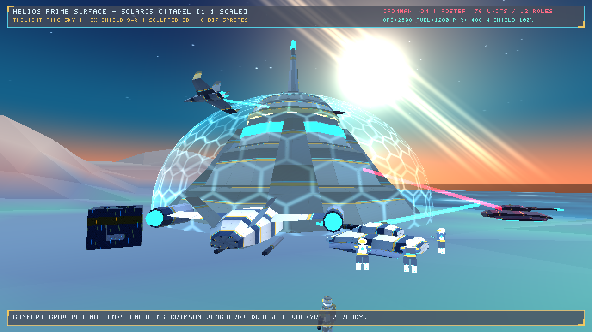
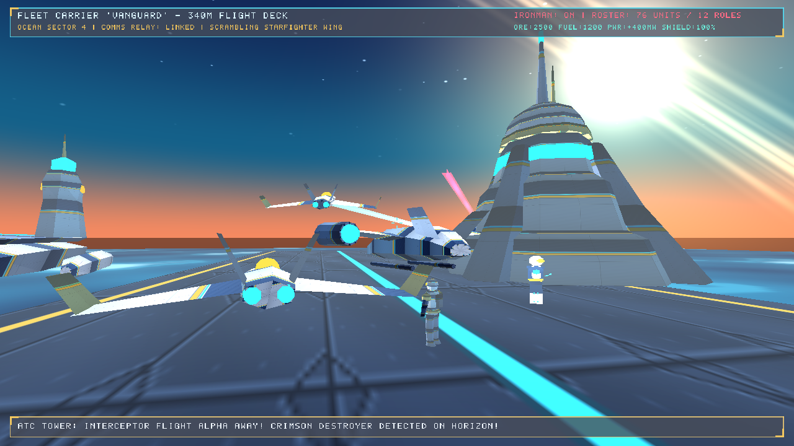
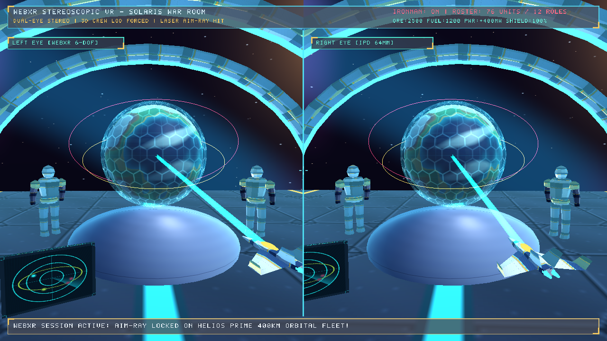

# 1stPRTS (`1prtsg`)

> **Command a planetary-to-orbital empire from the boots up — with one life on the line.**  
> An exclusively first-person Real-Time Strategy (RTS) game built in **C11 + SDL3 + OpenGL** with an external **Lua 5.4** gameplay layer, styled with a signature **Solaris Retro-Futurism** aesthetic (sculpted swept-hull silhouettes, glacier-titanium & cerulean-gold vs. obsidian & molten-coral palettes, sweeping twilight-ring & cosmic nebula skies, Fresnel rim-lit shading, and analytic hexagonal shields) on **true-scale spherical planets (`R = 6,371 km`) with real Keplerian orbital mechanics**, where all **76 enterable constructs** (buildings, ground vehicles, naval ships, aircraft, spacecraft, and space stations) are realistically huge (1:1 human scale), manned by **12 crew roles**, and fully explorable.

---

## Live Engine Screenshots (Solaris Retro-Futurism · SDL3 + OpenGL 3.3 Core — 0 GL Errors)

| War Room 3D Planetary & Orbital Holo-Globe | Planetary Surface 1:1 Scale & Shield Dome |
| :---: | :---: |
|  |  |

| Dropship Walkable Troop Bay (Orbital Ascent) | 400km Orbital Shipyard & Dreadnought Battle |
| :---: | :---: |
|  |  |

| Mobile Web Auto-Touch Virtual Controls | 340m Fleet Carrier 'Vanguard' Flight Deck |
| :---: | :---: |
|  |  |

| 1:1 Vehicle Foundry & Tactical Wrist-Pad | Dreadnought 'Solaris' Red-Alert Boarding & Meltdown |
| :---: | :---: |
|  |  |

| WebXR Stereoscopic Dual-Eye VR Holo-Globe | Live External Mod SDK (`--mod example_mod`) |
| :---: | :---: |
|  |  |

---

## Complete Feature Matrix (Phases 1–4 + Solaris Art Direction Overhaul)

- **Exclusively First-Person Commander & Hardcore Ironman (`src/world.c`, `src/controller.c`):** Zero god-camera. Walk inside 1:1 multi-deck interiors, interact with physical War Room **3D Planetary & Orbital Holo-Globes**, Factory Terminals, Pilot Seats, and Bridge Helms, take direct manual piloting control of any construct (then hand back to AI crew), and survive Critical Reactor Meltdowns via physical **Escape Pod** evacuation.
- **True-Scale Spherical Planet & Real Orbital Mechanics (`src/planet.c`, `src/controller.c`):** 64-bit geocentric coordinates, 6-face cube-sphere terrain/oceans, local ENU surface frames, exponential atmosphere, aerobraking shielded re-entry heat flux, Velocity-Verlet orbital integration, Keplerian elements, Hohmann delta-v transfers, and automated Astrogator ascent/rendezvous/docking/re-entry.
- **Doubled External Roster (`docs/ROSTER.md`, `scripts/units/`, `scripts/crew/`):** **76 distinct enterable constructs** (24 Buildings · 10 Ground Vehicles · 10 Naval Ships · 8 Aircraft · 14 Spacecraft · 10 Space Stations) + **12 crew/personnel roles** registered entirely from external MIT Lua 5.4 scripts.
- **Multi-Theater Economy, Spherical Horizon Sensors & Comms Relays (`src/economy.c`):** Ore/Fuel/Power/Manpower ledgers, 1:1 timed production queues, true planetary curvature horizon occlusion for Fog-of-War sensors (Orbital Recon Satellites), and multi-hop Comms Relay BFS networks (destroying a GEO Relay severs remote surface command links).
- **3D Spatial Audio & Orbital Acoustics (`src/audio.c`, `src/audio_sdl3.c`):** External WAV PCM decoder, 3D attenuation/panning, armored interior hull low-pass muffling, and orbital vacuum silence for airborne sounds while preserving hull-conducted vibration and radio comms.
- **Multi-Deck Capital Ship Boarding & Reactor Meltdowns (`src/boarding.c`):** Deck-by-deck marine assaults (`Hangar/Airlock` -> `Engineering` -> `Bridge/CIC`), hull decompression vacuum hazards requiring `mag_boots`, intact enemy flagship capture (flipping `faction_id`), and timed Critical Reactor Meltdown countdowns.
- **Solaris Retro-Futurism 3D Graphics, Auto-Touch Mobile Web & True Stereoscopic WebXR (`src/retro_renderer.c`, `src/gfx_gl.c`, `src/input.c`, `web/`):** Unified OpenGL 3.3 Core / OpenGL ES 3.0 / WebGL 2.0 renderer featuring sculpted multi-material vertex-colored `.obj` meshes, brushed satin titanium/obsidian/emerald-jade palettes, procedural twilight-ring & cosmic nebula sky domes (`sky.vert`/`sky.frag`), Fresnel rim-lit metallic shading with glowing emissive thrusters/canopies/light rails, vaulted interior arches, analytic hexagonal energy shields, hybrid 3D/8-dir sprite crew LOD (forced 3D inside interiors & VR), optional face-culled chunked voxels (`src/voxel.c`), automatic Mobile Web Touch controls, and side-by-side dual-viewport **WebXR 6-DOF Stereo VR** with laser aim-rays.
- **Zero Baked Assets, External Config, Live Hot-Reload & Deterministic Save/Load (`src/vfs.c`, `src/config.c`, `src/save_load.c`):** Every asset, script, config (`config/engine.cfg`), and mod (`mods/example_mod/`) sits loose beside the binary (fetched via `manifest.json` on Web), with runtime mtime hot-reload watching and deterministic `RTS_SAVE_V1` world snapshot serialization.

---

## Quick Build, Test & Coverage Verification

### Prerequisites
- C11 compiler (`gcc`, `clang`, or MSVC), CMake >= 3.24, Ninja (or Make), OpenGL development headers, Python 3.
- Dependencies (**SDL3**, **Lua 5.4**, **Unity**, **stb**) are fetched automatically by CMake `FetchContent` (all permissive licenses — see [`THIRD_PARTY_NOTICES.md`](THIRD_PARTY_NOTICES.md)).

### Build & Run All Tests + >= 95% Coverage Gates (Linux)

```bash
# Configure & build with coverage instrumentation
cmake --preset linux-coverage
cmake --build --preset linux-coverage -j$(nproc)

# Run 25 C Unity unit tests, Lua unit tests (>= 95% Lua coverage), and 18 headless automated game tests
find build/linux-coverage -name '*.gcda' -delete
ctest --preset linux-coverage --output-on-failure

# Verify >= 95% C11 core engine line coverage
python3 tools/check_coverage.py --build-dir build/linux-coverage --source-root . --min-line 95.0
```

### Run Interactively, Try Mods, or Capture Live OpenGL Screenshots

```bash
# Launch interactive SDL3 + OpenGL window (WASD walk/pilot, E interact, Tab Wrist-Pad, L live camera, keys 1-9 showcase scenes)
./build/linux-coverage/1prtsg --data-dir .

# Launch with the external Emerald Vanguard mod mounted (zero recompilation!)
./build/linux-coverage/1prtsg --data-dir . --mod example_mod

# Capture all 9 base 1280x720 OpenGL screenshots headlessly via Xvfb + Mesa
LIBGL_ALWAYS_SOFTWARE=1 xvfb-run -a -s "-screen 0 1280x720x24" \
  ./build/linux-coverage/1prtsg --data-dir . --capture-screenshots docs/screenshots
```

### Web / Mobile Auto-Touch / WebXR Build (Emscripten)

```bash
emcmake cmake --preset web-emscripten
cmake --build --preset web-emscripten
python3 tools/generate_manifest.py
# Serve repo root + web/index.html + 1prtsg.js + 1prtsg.wasm alongside loose assets/, scripts/, mods/, config/, manifest.json
```

---

## Documentation & OpenSpec

| Document | Purpose |
| :--- | :--- |
| [`docs/CONCEPT.md`](docs/CONCEPT.md) | Game Concept & Design Bible |
| [`docs/ROSTER.md`](docs/ROSTER.md) | Complete Doubled Roster (76 Enterable Constructs + 12 Crew Roles) |
| [`docs/ARCHITECTURE.md`](docs/ARCHITECTURE.md) | Technical Architecture & Verification Blueprint |
| [`docs/MODDING_GUIDE.md`](docs/MODDING_GUIDE.md) | Mod SDK, External Assets, Lua API Reference & Hot-Reload Guide |
| [`openspec/specs/`](openspec/specs/) | Canonical Archived OpenSpec Specifications (12 capabilities across Phases 1–4) |
| [`.github/workflows/ci.yml`](.github/workflows/ci.yml) | Cross-Platform CI (Linux Coverage/GL/ASan, Windows MSVC, macOS, Emscripten Web/WebXR) |

---

## Licensing

- **Code, Lua Scripts, Shaders, Build Files, Tests, and Documentation:** [MIT License](LICENSE-CODE)
- **Art and Audio Assets:** [Creative Commons Attribution 4.0 International (CC BY 4.0)](LICENSE-ART)

See [`LICENSE`](LICENSE) and [`THIRD_PARTY_NOTICES.md`](THIRD_PARTY_NOTICES.md) for details.
