# 1stPRTS (`1prtsg`)

> **Play Live in Browser (WebGL 2 · Mobile Auto-Touch · WebXR VR):** **[https://stbange.github.io/1prtsg/](https://stbange.github.io/1prtsg/)**
>
> **Command a planetary-to-orbital empire from the boots up — with one life on the line.**  
> An exclusively first-person Real-Time Strategy (RTS) game built in **C11 + SDL3 + OpenGL** with an external **Lua 5.4** gameplay layer, styled with a signature **Solaris Retro-Futurism** aesthetic (sculpted swept-hull silhouettes, glacier-titanium & cerulean-gold vs. obsidian & molten-coral palettes, sweeping twilight-ring & cosmic nebula skies, Fresnel rim-lit shading, and analytic hexagonal shields) on **true-scale spherical planets (`R = 6,371 km`) with real Keplerian orbital mechanics**, where all **76 enterable constructs** (buildings, ground vehicles, naval ships, aircraft, spacecraft, and space stations) are realistically huge (1:1 human scale), manned by **12 crew roles**, and fully explorable.

---

## Live Engine Screenshots (Solaris Retro-Futurism · SDL3 + OpenGL 3.3 Core — 0 GL Errors)

| War Room 3D Planetary & Orbital Holo-Globe | Planetary Surface 1:1 Scale & Shield Dome |
| :---: | :---: |
|  |  |

| Dropship Walkable Troop Bay (Orbital Ascent) | 400km Orbital Shipyard & Dreadnought Battle |
| :---: | :---: |
| 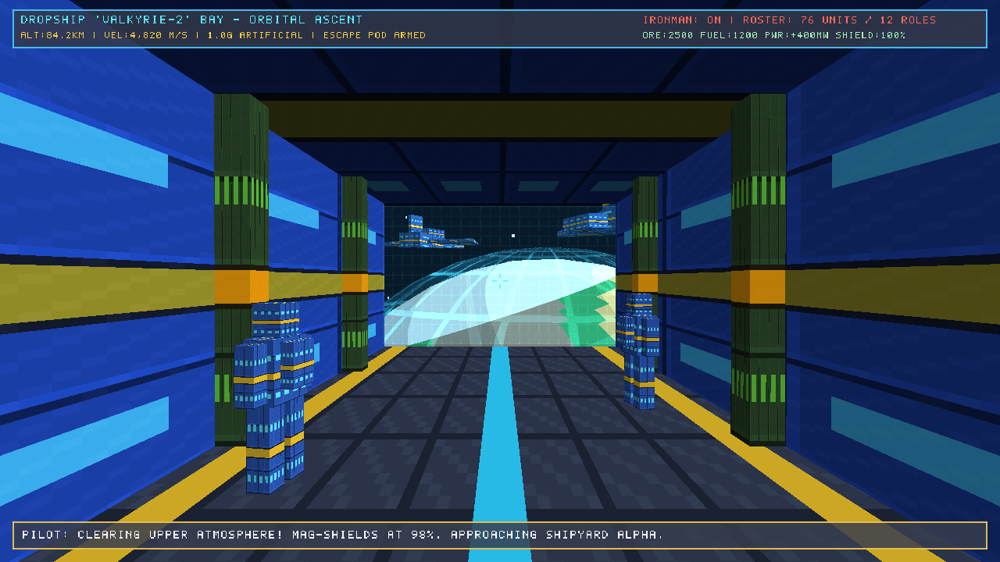 | 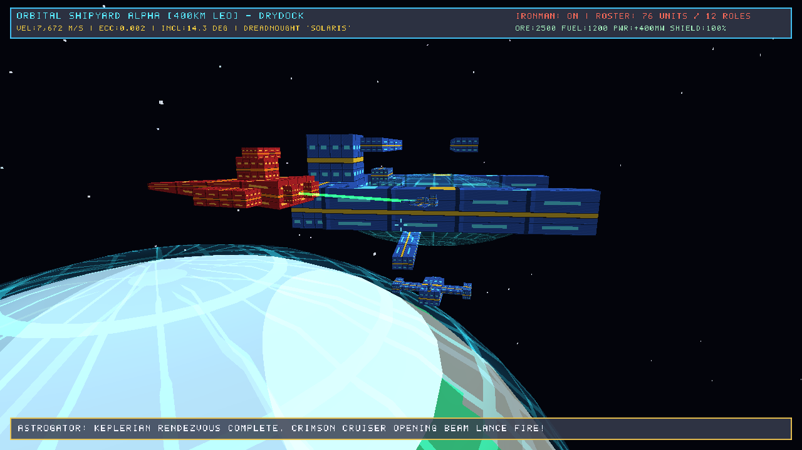 |

| Mobile Web Auto-Touch Virtual Controls | 340m Fleet Carrier 'Vanguard' Flight Deck |
| :---: | :---: |
|  |  |

| 1:1 Vehicle Foundry & Tactical Wrist-Pad | Dreadnought 'Solaris' Red-Alert Boarding & Meltdown |
| :---: | :---: |
| 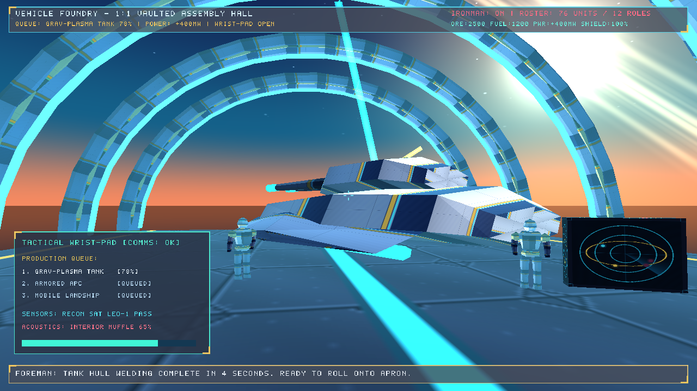 | 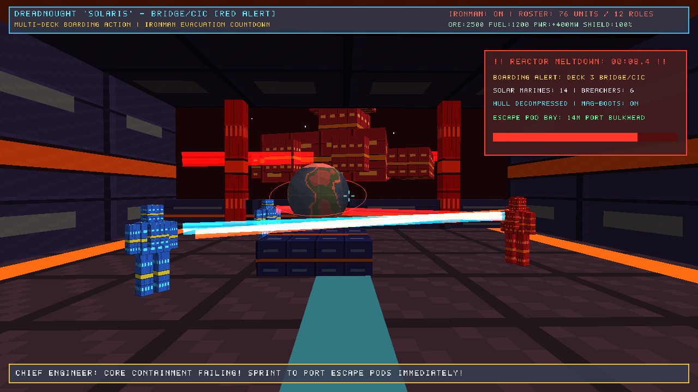 |

| WebXR Stereoscopic Dual-Eye VR Holo-Globe | Live External Mod SDK (`--mod example_mod`) |
| :---: | :---: |
|  | 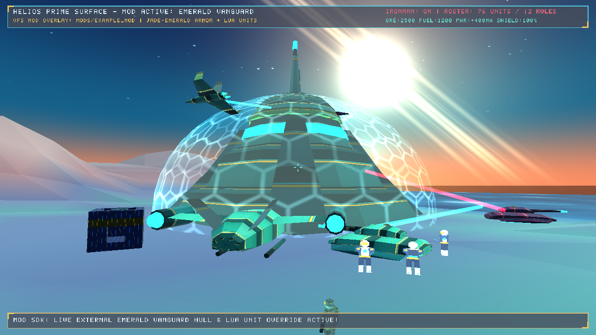 |

---

## Complete 76-Construct Unique Model & Enterable Interior Gallery (`assets/models/<id>.obj` + `scripts/interiors/catalog.lua`)

Every single one of the **76 constructs** across all 6 classes ships with its own unique sculpted Solaris Retro-Futurism `.obj` model loaded dynamically via VFS (`rts_renderer_get_mesh`) and its own tailored multi-deck enterable interior layout (rooms, airlock portals, and role-accurate consoles):

| Class 0: 24 Planetary Buildings | Class 1: 10 Ground Vehicles |
| :---: | :---: |
| 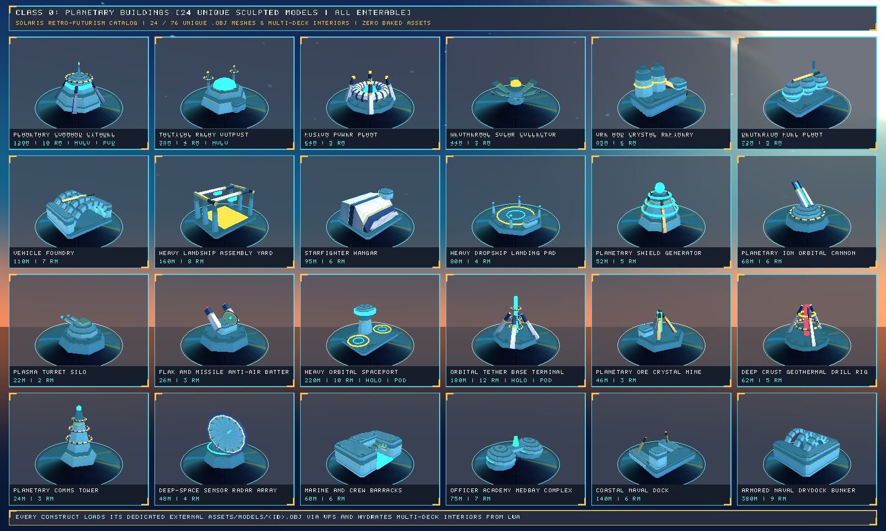 | 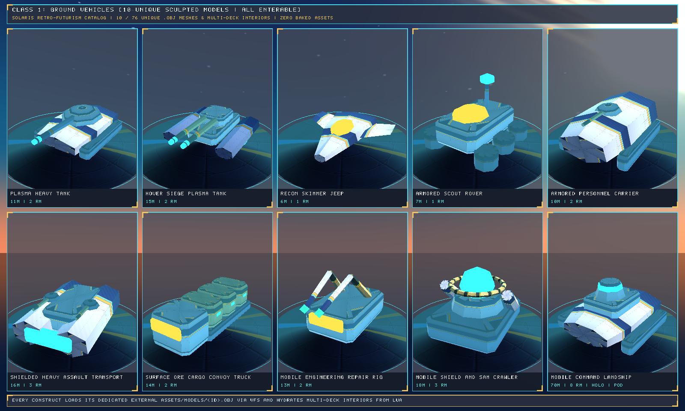 |

| Class 2: 10 Naval Ships | Class 3: 8 Aircraft & Transports |
| :---: | :---: |
| 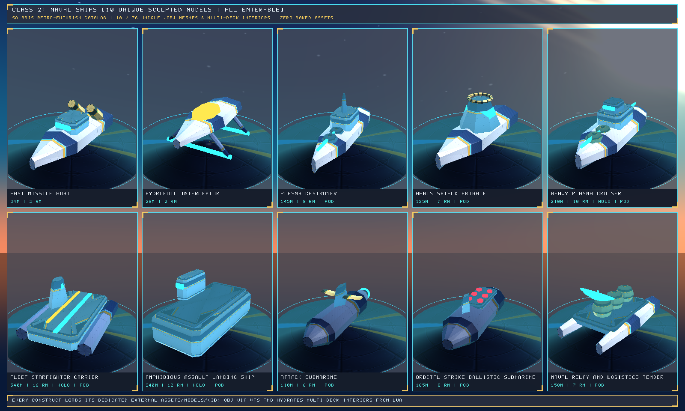 | 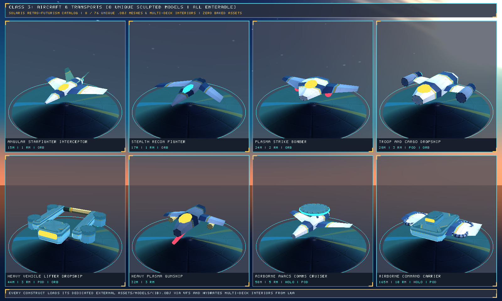 |

| Class 4: 14 Orbital & Deep-Space Craft | Class 5: 10 Space Stations & Drydocks |
| :---: | :---: |
| 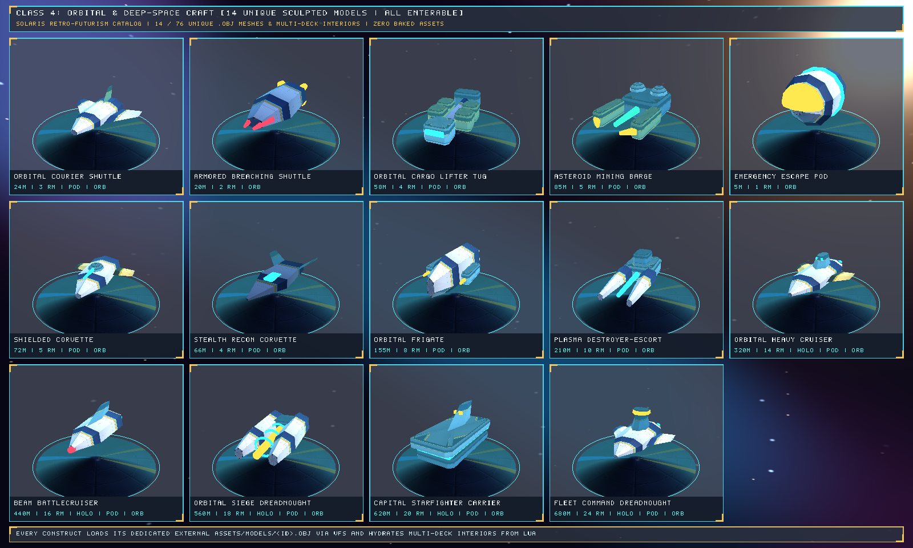 | 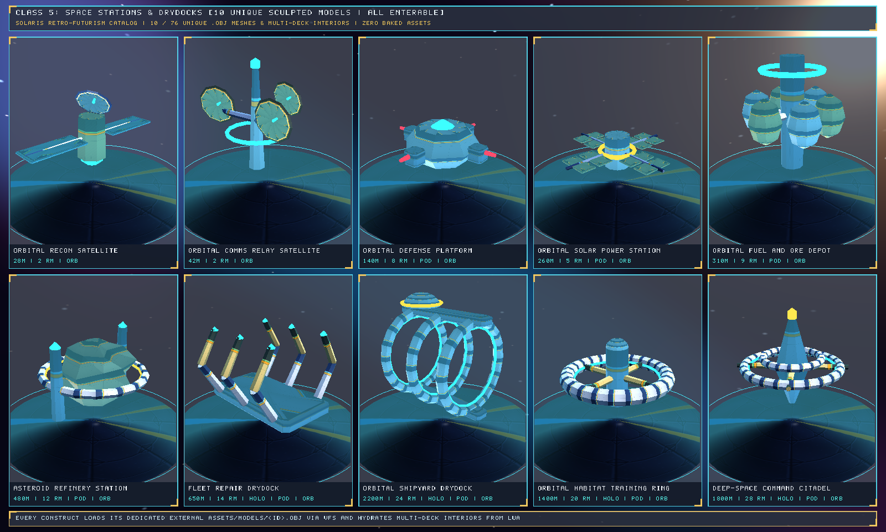 |

### Seamless First-Person Planetary-to-Orbital Sandbox RTS (`Mode M`)
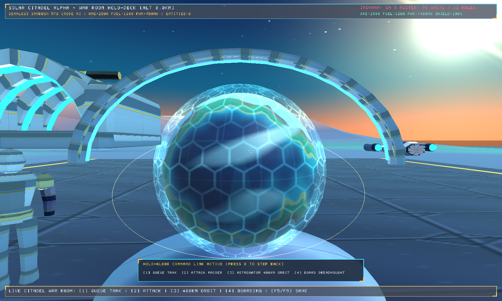

---

## Explorable 1–420 Room Multi-Deck Mega-Interiors & Living 12-Role Crew (`src/interior_gen.c`, `src/crew_sim.c`)

Every construct scales deterministically from a 1-room Starfighter cockpit to **420 fully connected rooms across 20 decks** on capital ships and orbital stations (`Dreadnought Solaris`, `Orbital Shipyard Drydock`, `Deep-Space Command Citadel`), complete with open walk-through bulkhead doorways, vertical **Turbolifts** (`[`/`]` or `E`), a live **Diegetic Deck Blueprint Minimap**, and a **fully staffed 12-role living crew** (Command Officers, Pilots, Astrogators, Gunners, Shield Techs, Comms Officers, Engineers, Medics, patrolling Solar Marines, Flight Deck Crew, Hull Mechanics, and Quartermasters) who actively work stations, patrol corridors, weld-repair damaged cores, and repel Crimson Breachers during Red Alert (`F`):

| 420-Room Dreadnought Deck 1 Bridge & 400km LEO View | Multi-Room Spine Corridor, Turbolift & Patrolling Marines |
| :---: | :---: |
| 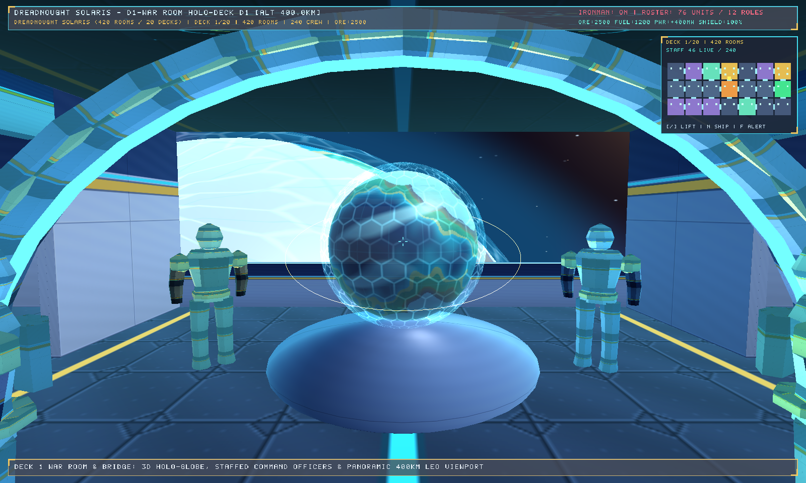 | 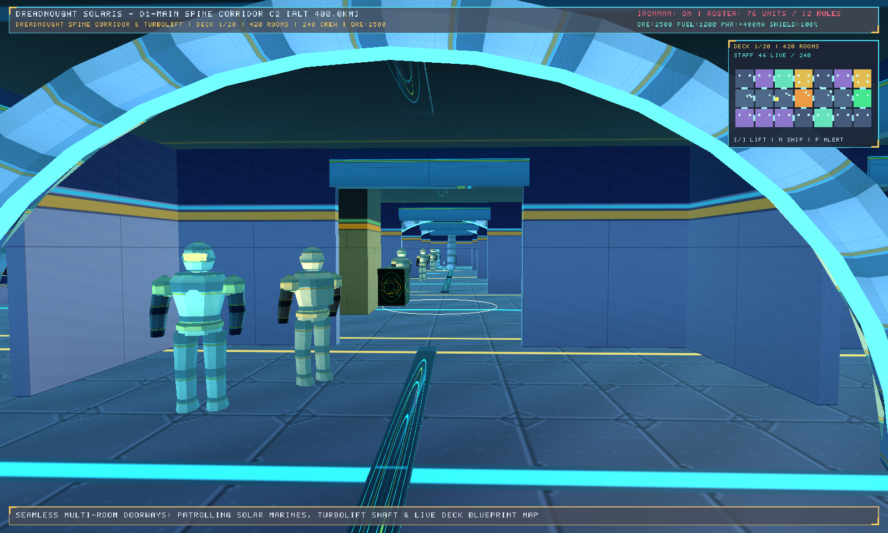 |

| 420-Room Orbital Shipyard Deck 14 Reactor Core (Red Alert) | 150-Room Fleet Carrier Deck 2 Starfighter Hangar Bay |
| :---: | :---: |
| 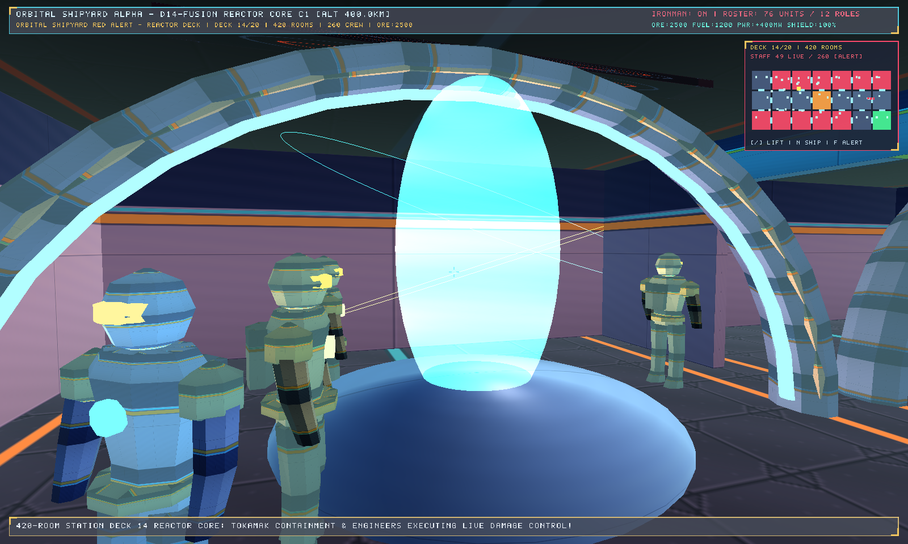 | 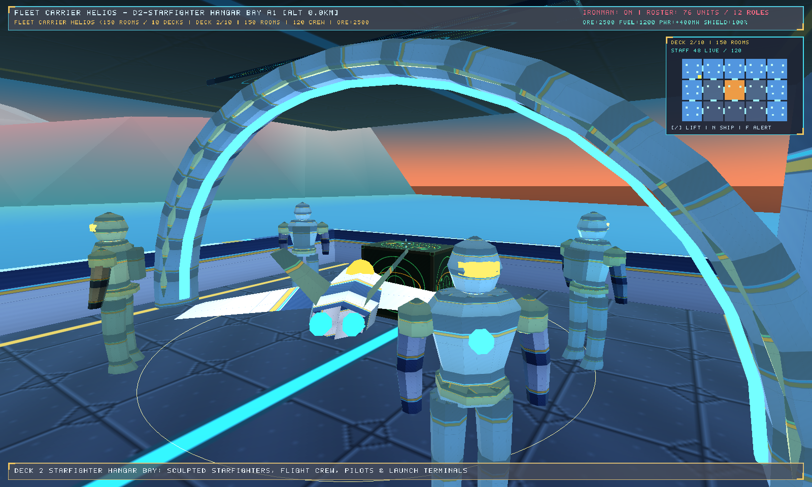 |

---

## Interactive First-Person RTS Toolkit — Tier 1, Tier 2 & Tier 3 (`src/hologlobe_ui.c`, `src/field_gear.c`)

Command your planetary and orbital war effort strictly from first-person through three seamless diegetic command tiers — with zero god-camera:

- **Tier 3 — War Room 3D Planetary & Orbital Holo-Globe (`E` at Holo-Globe):** True 3D raycast unit picking (mouse/touch/WebXR ray) respecting spherical-horizon Fog of War, smooth planetary spin & zoom (`36,000 km` GEO down to `4 km` theater), drag/box selection, all 7 surface & orbital order modes (`[1] Select`, `[2] Move`, `[3] Attack`, `[4] Orbit`, `[5] Dock`, `[6] Re-entry`, `[7] Board`), and validated 3D holographic ghost placement (`[X]` + `LMB`) for all 24 Planetary Buildings & 10 Space Stations.
- **Tier 1 — Personal Field Gear:** 4-Tab Diegetic **Tactical Wrist-Pad** (`Tab`: `1 Radar` obeying Fog of War + Comms Relay status, `2 Deck`, `3 Fleet`, `4 Economy & Queue`), **1x / 4x / 12x Optical Binoculars & 3D Laser Designator** (`Z` + `LMB` orbital/artillery strike call), and **7-Order Radial Quick Wheel** (`V` / Right-Click: `Escort`, `Move`, `Attack`, `Orbit`, `Dock`, `Board`, `Evacuate`).
- **Tier 2 — Facility Production Terminals & 1:1 Progressive Gantry Assembly:** Walk up to any Foundry, Coastal Dock, Hangar, or Orbital Shipyard terminal (`E` -> `1-6`) to queue class-filtered units and watch active `RtsProductionJob`s assemble progressively at **1:1 scale** inside cyan wireframe scaffolds under 4 gantry pylons firing plasma welding arcs!

| Tier 3: Interactive 3D Holo-Globe Raycast & Ghost Placement | Tier 1: 4-Tab Diegetic Tactical Wrist-Pad & Horizon Radar |
| :---: | :---: |
| 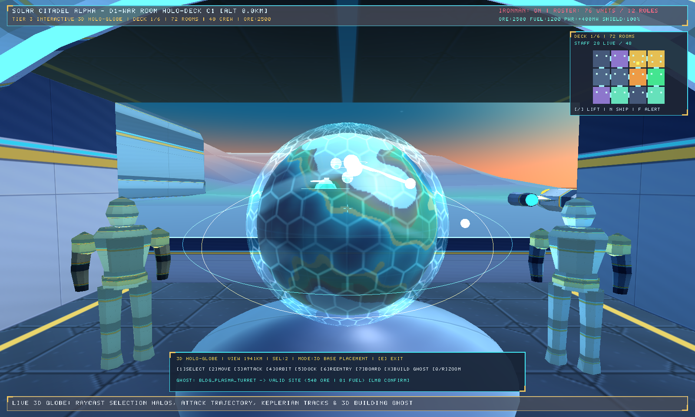 | 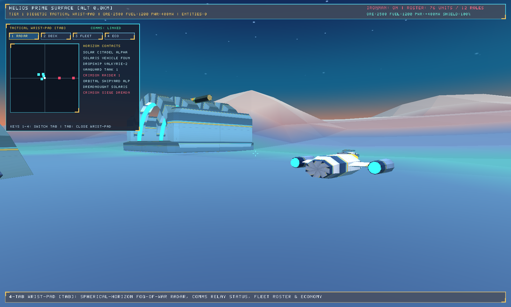 |

| Tier 1: 4x/12x Optical Binoculars, 3D Laser Beacon & Radial Wheel | Tier 2: Foundry Build Terminal & 1:1 Progressive Gantry Assembly |
| :---: | :---: |
| 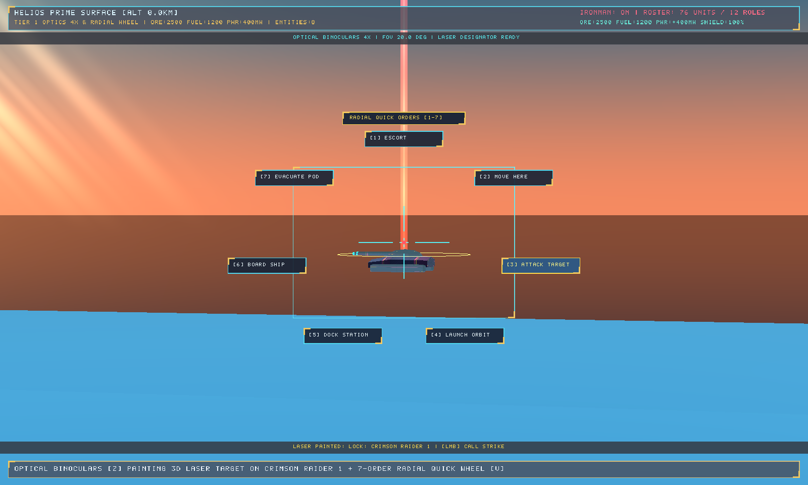 | 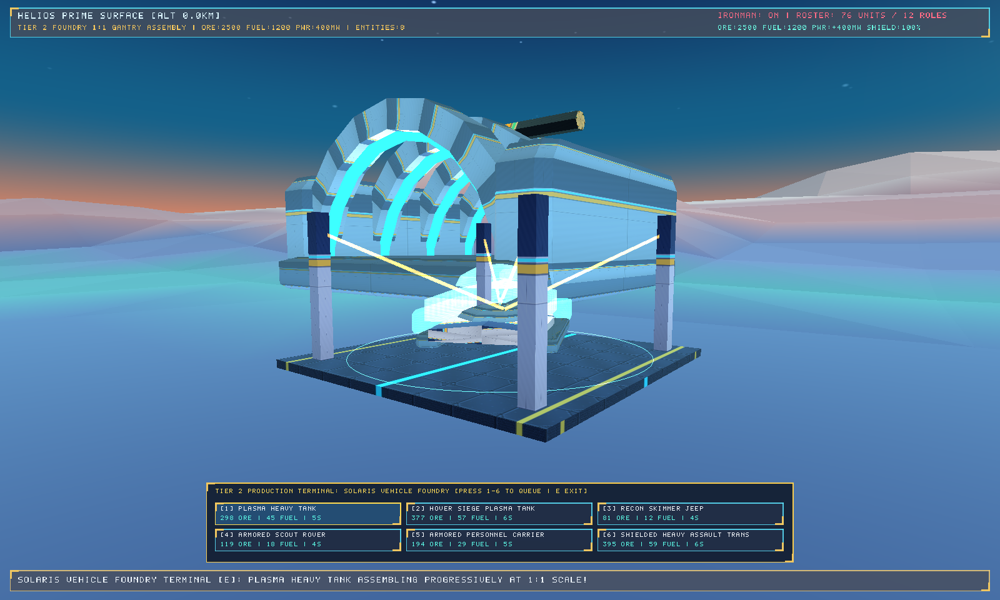 |

---

## Spherical Planetary Terrain, Animated Oceans, 6-Class Vehicle Physics & Unified Live Combat (`src/planet_mesh.c`, `src/vehicle_physics.c`, `src/combat_sim.c`)

- **Continuous Multi-LOD Spherical Terrain & Animated Oceans:** Dynamically generated camera-relative cube-sphere terrain tiles, alpine ridges, shoreline beaches, animated wave oceans, and high-altitude clouds smoothly scaling from 1m boots-on-ground up to full orbital planet horizon (`R = 6,371 km`) with zero floating-point jitter.
- **6-Class Piloting, Dropship Cargo Clamping & Safe Time Compression:** Hover-cushion slope/turret physics for Ground Vehicles; ocean wave buoyancy & Submarine ballast diving (`Space`/`Ctrl`); VTOL hover-to-forward flight with **Dropship Cargo Bay Clamping (`K`)** to haul a Plasma Tank to orbit; and 6-DOF Newtonian spacecraft burns with atmospheric plasma re-entry heating + safe **`1x/2x/4x/8x` Time Compression (`.`)**.
- **Unified 64-Bit Live-World Combat & Voxel Craters:** EMP-Prime (`x2.4` synergy), Orbital Ion Cannons, Continuous Beam Lances, Homing Torpedoes, AA Flak, directional Hex-Shield ripples, physical compartment hitboxes propagating subsystem breaches into `RtsMegaInterior` rooms for Engineers to weld-repair, and destructible voxel crater carving!

| Multi-LOD Spherical Terrain, Ocean Bay & Submarine Ballast | Class 3 Heavy Lifter VTOL & Clamped Plasma Tank Cargo |
| :---: | :---: |
| 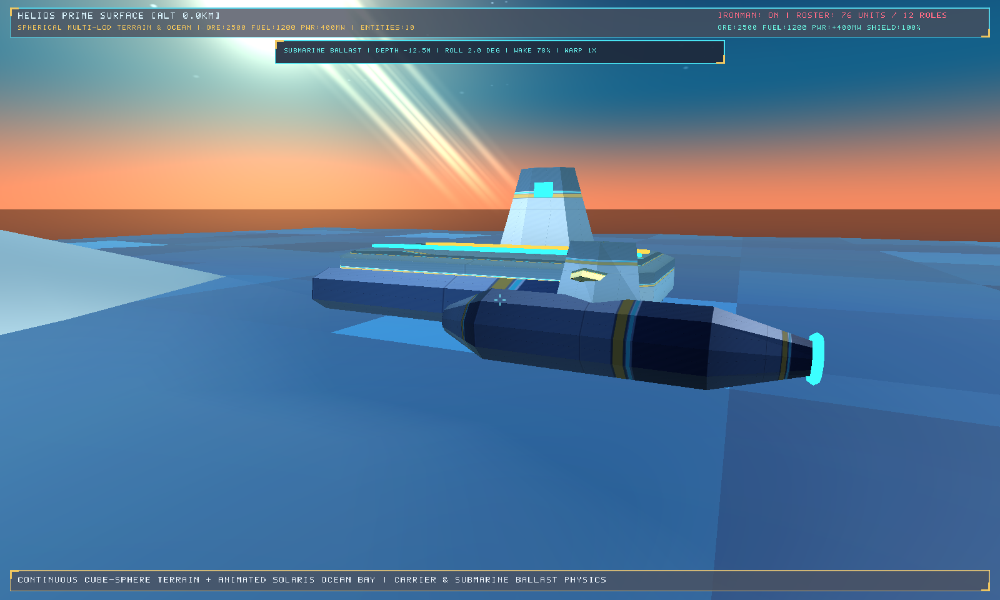 | 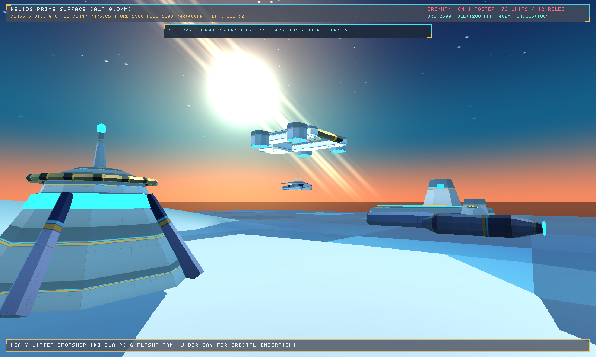 |

| Unified 64-Bit Live Combat, EMP x2.4, Ion Beam & Voxel Crater | 6-DOF Spacecraft Atmospheric Re-entry & 4x Time Warp |
| :---: | :---: |
| 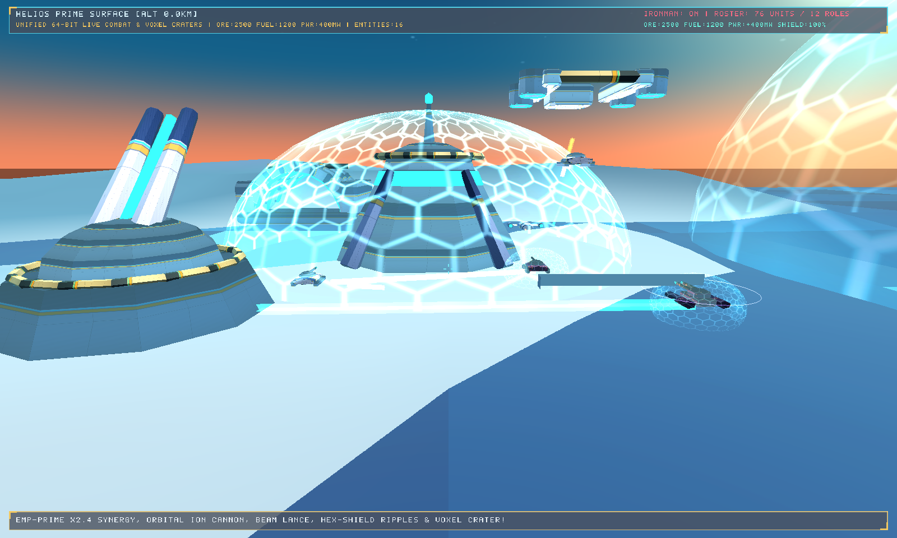 | 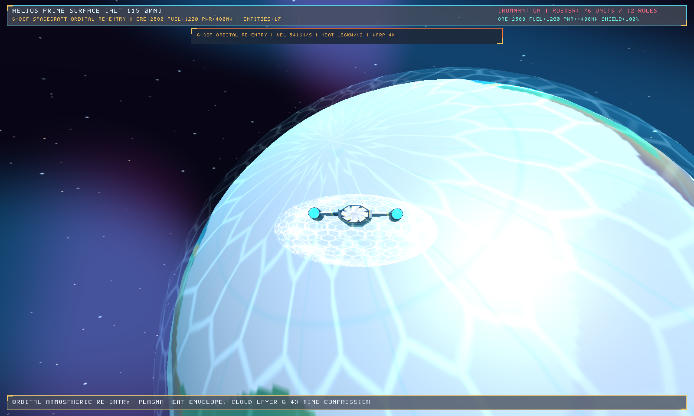 |

---

## Solaris Main Menu, Autonomous Strategic AI, Physical Logistics, 4 Scenarios & 5-Slot Persistent Saves (`src/ui_menus.c`, `scripts/ai/strategic_ai.lua`, `scripts/rules/logistics.lua`)

- **Solaris Main Menu & Live 3D Orbital Backdrop:** Boots directly into a sleek glass Solaris Command menu floating above rotating Helios Prime, Orbital Shipyard Alpha, and Dreadnought Solaris — offering one-click entry into **Planetary-to-Orbital Skirmish** (Hardcore Ironman ON default, toggleable; Balanced/Aggressive AI), **Free-Explore Sandbox** (all 76 constructs), **Tactical Defense**, **4 Curated Scenarios**, **5-Slot Persistent Saves** (OS files on Desktop + `localStorage` on GitHub Pages Web), **Pause Menu (`Esc`)**, and **Mod Manager**.
- **Autonomous Strategic AI & Physical Convoy Logistics:** Enemy factions expand mines, foundries, spaceports, orbital shipyards, and severable GEO Comms Relays while Ore Cargo Trucks, Naval Relay Tenders, and Orbital Lifters physically shuttle supplies along raidable logistics routes!

| Default Solaris Main Menu & 3D Orbital Backdrop | Planetary-to-Orbital Skirmish Configurator |
| :---: | :---: |
| 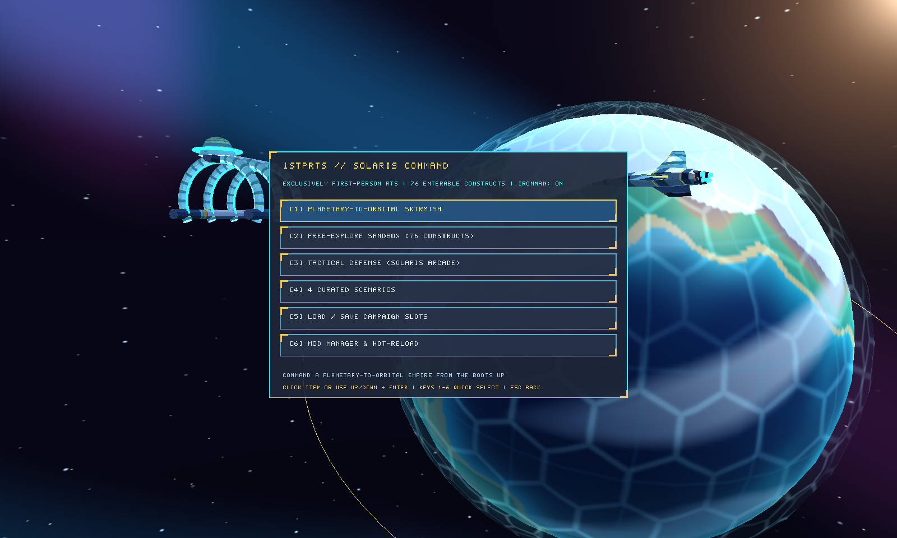 | 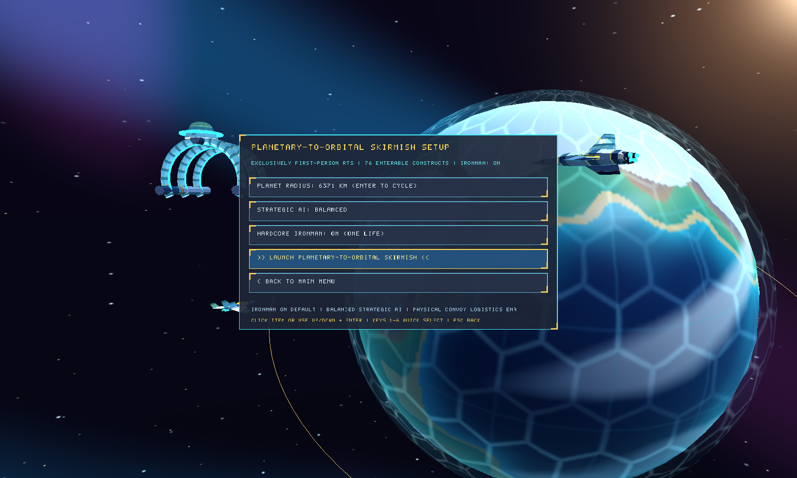 |

| Curated Scenario #3: Escape the Flagship (60s Meltdown) | Persistent 5-Slot Save/Load Browser (Disk & Web) |
| :---: | :---: |
| 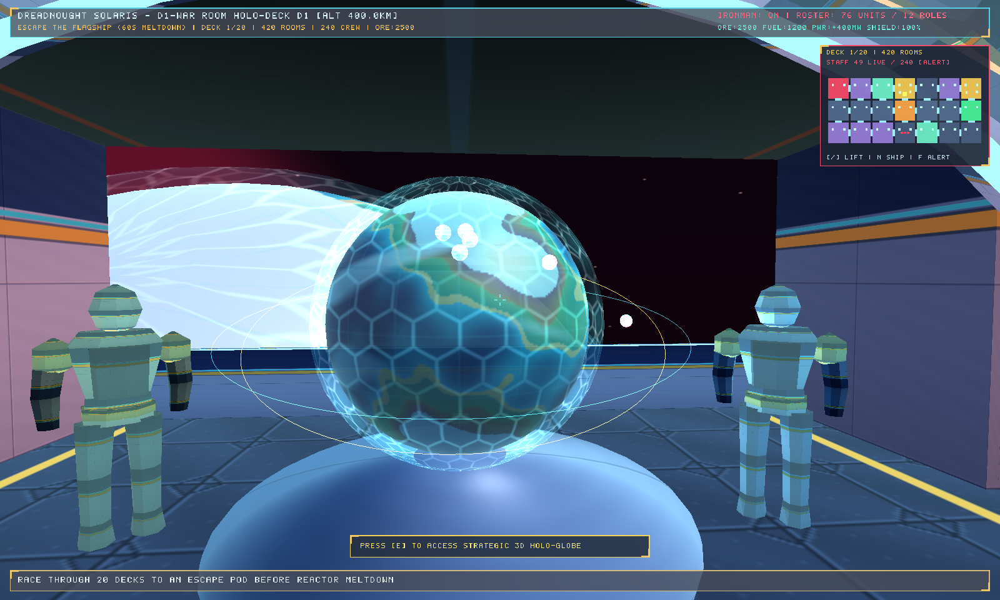 | 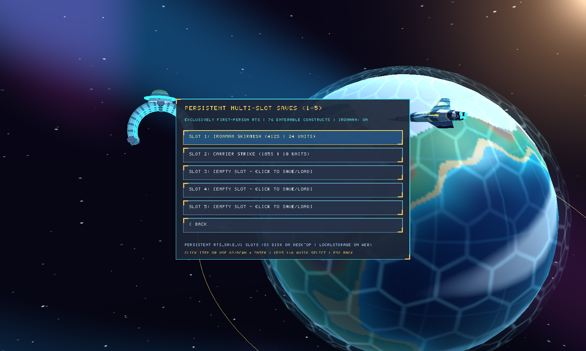 |

---

## Complete Feature Matrix (Phases 1–4 + Solaris Art Direction + 76 Unique Models + 1–420 Room Mega-Interiors + Tier 1/2/3 RTS Toolkit)

- **Exclusively First-Person Commander & Hardcore Ironman (`src/world.c`, `src/controller.c`):** Zero god-camera. Walk seamlessly across interconnected rooms through open bulkhead doorways inside 1:1 multi-deck interiors, ride vertical **Turbolifts** across up to 20 decks, interact with physical War Room **3D Planetary & Orbital Holo-Globes**, Factory Terminals, Pilot Seats, and Bridge Helms, take direct manual piloting control of any construct (then hand back to AI crew), and survive Critical Reactor Meltdowns via physical **Escape Pod** evacuation.
- **Full Interactive Tier 1/2/3 First-Person RTS Toolkit (`src/hologlobe_ui.c`, `src/field_gear.c`, `scripts/ui/diegetic_ui.lua`):** True 3D Holo-Globe raycast selection, box-selection, 7-mode surface/orbital orders & validated 3D base/station ghost placement; 4-Tab Diegetic Tactical Wrist-Pad (`Tab`); 1x/4x/12x Optical Binoculars & 3D Laser Strike Designator (`Z` + `LMB`); 7-Order Radial Quick Wheel (`V`/Right-Click); and Tier 2 Facility Build Consoles (`E` -> `1-6`) with live 1:1 progressive gantry welding assembly.
- **Explorable 1–420 Room Mega-Interiors & Living 12-Role Crew (`src/interior_gen.c`, `src/crew_sim.c`):** Deterministic multi-deck floorplans for all **76 constructs** with 100% BFS-verified doorway connectivity, active-deck streaming, room-specific 3D props (Tokamak Reactor Cores, Shield Cores, Hangar Starfighters, Turbolift Shafts, Medbay Pods, Armory Lockers, illuminated corridor stripes), top-right **Diegetic Deck Blueprint Minimap**, and living 12-role staffed crew performing station work, corridor patrols, Engineer weld repairs, and Marine counter-boarding defense.
- **True-Scale Spherical Planet & Real Orbital Mechanics (`src/planet.c`, `src/controller.c`):** 64-bit geocentric coordinates, 6-face cube-sphere terrain/oceans, local ENU surface frames, exponential atmosphere, aerobraking shielded re-entry heat flux, Velocity-Verlet orbital integration, Keplerian elements, Hohmann delta-v transfers, and automated Astrogator ascent/rendezvous/docking/re-entry.
- **Doubled External Roster (`docs/ROSTER.md`, `scripts/units/`, `scripts/interiors/catalog.lua`, `scripts/crew/`):** **76 distinct enterable constructs** (24 Buildings · 10 Ground Vehicles · 10 Naval Ships · 8 Aircraft · 14 Spacecraft · 10 Space Stations), each with its own dedicated sculpted `.obj` model (`assets/models/<id>.obj`) and tailored multi-deck enterable interior + **12 crew/personnel roles** registered entirely from external MIT Lua 5.4 scripts.
- **Multi-Theater Economy, Spherical Horizon Sensors & Comms Relays (`src/economy.c`):** Ore/Fuel/Power/Manpower ledgers, 1:1 timed production queues, true planetary curvature horizon occlusion for Fog-of-War sensors (Orbital Recon Satellites), and multi-hop Comms Relay BFS networks (destroying a GEO Relay severs remote surface command links).
- **3D Spatial Audio & Orbital Acoustics (`src/audio.c`, `src/audio_sdl3.c`):** External WAV PCM decoder, 3D attenuation/panning, armored interior hull low-pass muffling, and orbital vacuum silence for airborne sounds while preserving hull-conducted vibration and radio comms.
- **Multi-Deck Capital Ship Boarding & Reactor Meltdowns (`src/boarding.c`):** Deck-by-deck marine assaults (`Hangar/Airlock` -> `Engineering` -> `Bridge/CIC`), hull decompression vacuum hazards requiring `mag_boots`, intact enemy flagship capture (flipping `faction_id`), and timed Critical Reactor Meltdown countdowns.
- **Solaris Retro-Futurism 3D Graphics, Pointer Lock WebGL 2, Auto-Touch Mobile Web & True Stereoscopic WebXR (`src/retro_renderer.c`, `src/gfx_gl.c`, `src/input.c`, `web/`):** Unified OpenGL 3.3 Core / OpenGL ES 3.0 / WebGL 2.0 renderer featuring sculpted multi-material vertex-colored `.obj` meshes, brushed satin titanium/obsidian/emerald-jade palettes, procedural twilight-ring & cosmic nebula sky domes (`sky.vert`/`sky.frag`), Fresnel rim-lit metallic shading with glowing emissive thrusters/canopies/light rails, vaulted interior arches, analytic hexagonal energy shields, hybrid 3D/8-dir sprite crew LOD (forced 3D inside interiors & VR), optional face-culled chunked voxels (`src/voxel.c`), browser Pointer Lock 360° mouse look + WebAudio unlock, automatic Mobile Web Touch controls, and side-by-side dual-viewport **WebXR 6-DOF Stereo VR** with laser aim-rays.
- **Zero Baked Assets, External Config, Live Hot-Reload & Deterministic Save/Load (`src/vfs.c`, `src/config.c`, `src/save_load.c`):** Every asset, script, config (`config/engine.cfg`), and mod (`mods/example_mod/`) sits loose beside the binary (fetched via `manifest.json` on Web), with runtime mtime hot-reload watching and deterministic `RTS_SAVE_V1` world snapshot serialization.

---

## Quick Build, Test & Coverage Verification

### Prerequisites
- C11 compiler (`gcc`, `clang`, or MSVC), CMake >= 3.24, Ninja (or Make), OpenGL development headers, Python 3.
- Dependencies (**SDL3**, **Lua 5.4**, **Unity**, **stb**) are fetched automatically by CMake `FetchContent` (all permissive licenses — see [`THIRD_PARTY_NOTICES.md`](THIRD_PARTY_NOTICES.md)).

### Build & Run All Tests + >= 95% Coverage Gates (Linux)

```bash
# Configure & build with coverage instrumentation
cmake --preset linux-coverage
cmake --build --preset linux-coverage -j$(nproc)

# Run C Unity unit tests, Lua unit tests (>= 95% Lua coverage), and 22 headless automated game tests
find build/linux-coverage -name '*.gcda' -delete
ctest --preset linux-coverage --output-on-failure

# Verify >= 95% C11 core engine line coverage
python3 tools/check_coverage.py --build-dir build/linux-coverage --source-root . --min-line 95.0
```

### Run Interactively, Try Mods, or Capture Live OpenGL Screenshots

```bash
# Launch interactive SDL3 + OpenGL window:
#   L = Live Solaris Tactical Defense | M = Seamless Sandbox RTS & Explorable Mega-Interiors
#   WASD = Walk Rooms/Pilot | [/] = Turbolift Deck Up/Down | N = Cycle Megaships (72..420 Rooms)
#   Tab = 4-Tab Tactical Wrist-Pad [1-4 Tabs] | Z = 1x/4x/12x Optical Binoculars & Laser [LMB Strike]
#   V / RMB = 7-Order Radial Quick Wheel [1-7] | E = Holo-Globe [1-7, X Ghost, Q/R Zoom] or Facility Terminal [1-6]
#   F = Red Alert (Crew Repair & Counter-Boarding) | B = Board/EVA | G = 400km Orbit | F5/F9 = Quicksave/Quickload
#   C = 76-Unit 3D Catalog | Keys 1-9 = Showcase Scenes
./build/linux-coverage/1prtsg --data-dir .

# Launch with the external Emerald Vanguard mod mounted (zero recompilation!)
./build/linux-coverage/1prtsg --data-dir . --mod example_mod

# Capture all 4 live OpenGL 3.3 Core Tier 1/2/3 Interactive RTS Toolkit screenshots
LIBGL_ALWAYS_SOFTWARE=1 xvfb-run -a -s "-screen 0 1600x960x24" \
  ./build/linux-coverage/1prtsg --data-dir . --width 1600 --height 960 --capture-rts-toolkit docs/screenshots

# Capture all 4 live OpenGL 3.3 Core Explorable Mega-Interior & Living Crew screenshots
LIBGL_ALWAYS_SOFTWARE=1 xvfb-run -a -s "-screen 0 1600x960x24" \
  ./build/linux-coverage/1prtsg --data-dir . --width 1600 --height 960 --capture-mega-interiors docs/screenshots

# Capture all 6 class galleries (76 unique sculpted constructs!) + live Sandbox RTS frame
LIBGL_ALWAYS_SOFTWARE=1 xvfb-run -a -s "-screen 0 1600x960x24" \
  ./build/linux-coverage/1prtsg --data-dir . --width 1600 --height 960 --capture-roster-gallery docs/screenshots

# Capture all 9 base 1280x720 OpenGL showcase screenshots headlessly via Xvfb + Mesa
LIBGL_ALWAYS_SOFTWARE=1 xvfb-run -a -s "-screen 0 1280x720x24" \
  ./build/linux-coverage/1prtsg --data-dir . --capture-screenshots docs/screenshots
```

### Web / Mobile Auto-Touch / WebXR Build (Emscripten)

```bash
emcmake cmake --preset web-emscripten
cmake --build --preset web-emscripten
python3 tools/generate_manifest.py
# Serve repo root + web/index.html + 1prtsg.js + 1prtsg.wasm alongside loose assets/, scripts/, mods/, config/, manifest.json
```

---

## Documentation & OpenSpec

| Document | Purpose |
| :--- | :--- |
| [`docs/CONCEPT.md`](docs/CONCEPT.md) | Game Concept & Design Bible |
| [`docs/ROSTER.md`](docs/ROSTER.md) | Complete Doubled Roster (76 Enterable Constructs + 12 Crew Roles) |
| [`docs/ARCHITECTURE.md`](docs/ARCHITECTURE.md) | Technical Architecture & Verification Blueprint |
| [`docs/MODDING_GUIDE.md`](docs/MODDING_GUIDE.md) | Mod SDK, External Assets, Lua API Reference & Hot-Reload Guide |
| [`openspec/specs/`](openspec/specs/) | Canonical Archived OpenSpec Specifications (13 capabilities across Milestones 001–010) |
| [`.github/workflows/ci.yml`](.github/workflows/ci.yml) | Cross-Platform CI (Linux Coverage/GL/ASan, Windows MSVC, macOS, Emscripten Web/WebXR) |

---

## Licensing

- **Code, Lua Scripts, Shaders, Build Files, Tests, and Documentation:** [MIT License](LICENSE-CODE)
- **Art and Audio Assets:** [Creative Commons Attribution 4.0 International (CC BY 4.0)](LICENSE-ART)

See [`LICENSE`](LICENSE) and [`THIRD_PARTY_NOTICES.md`](THIRD_PARTY_NOTICES.md) for details.
