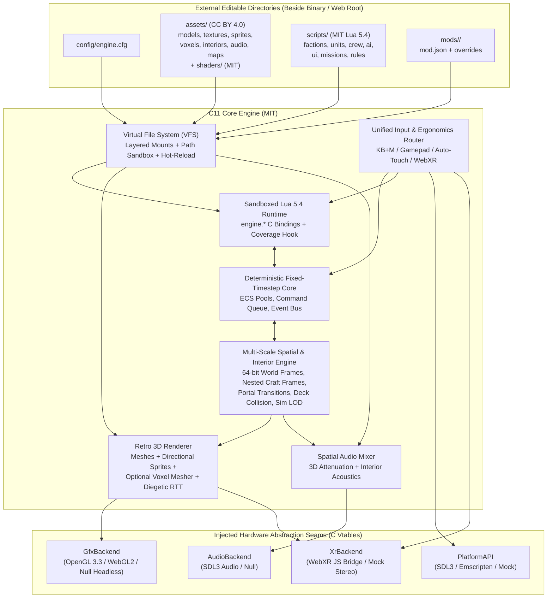
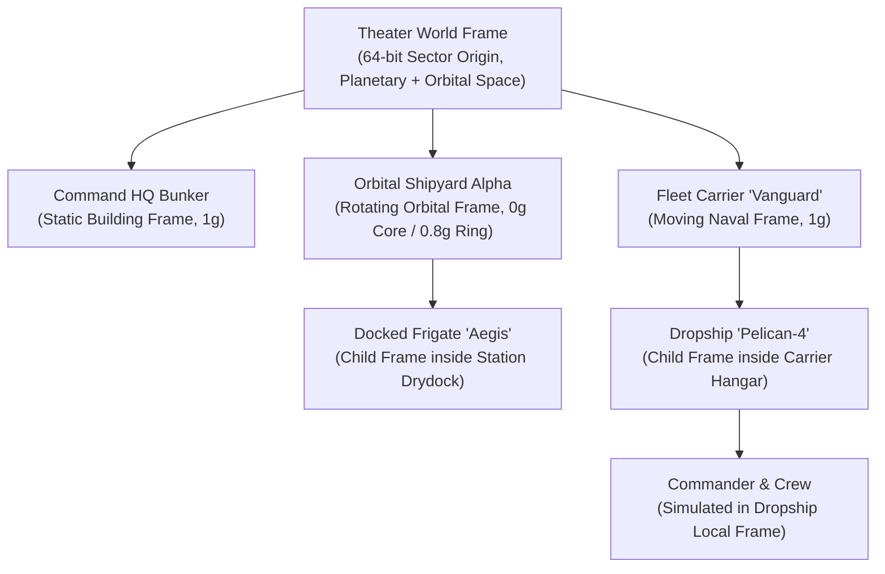
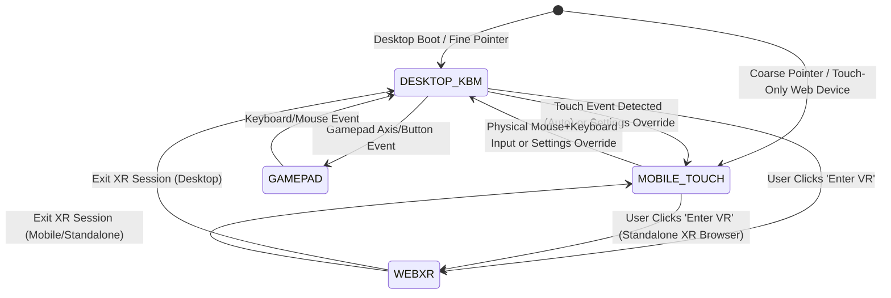

# 1stPRTS (`1prtsg`) — Technical Architecture Blueprint

> **Language:** C11 (Core Engine) + Lua 5.4 (Scripted Gameplay Layer)  
> **Platform & Graphics:** SDL3 + OpenGL (Unified OpenGL 3.3 Core / OpenGL ES 3.0 / WebGL 2.0) + WebXR  
> **Quality Gates:** OpenSpec Spec-Driven Development · >= 95% Unit Test Coverage · Automated End-to-End Game Tests  
> **Asset Policy:** 100% External Assets & Scripts beside the binary (zero baked assets)

---

## 1. Architectural Tenets

1. **Strict Engine / Gameplay Separation:** The C11 core engine knows *how* to simulate nested 3D interiors, render retro 3D scenes, route inputs, mix spatial audio, and load layered VFS assets — it contains **zero hardcoded factions, units, tech trees, weapons, or missions**. All game rules live in external Lua 5.4 scripts.
2. **Single Portable Rendering Core:** One OpenGL shader/pipeline core targets **OpenGL 3.3 Core** (Windows, Linux, macOS) and **OpenGL ES 3.0 / WebGL 2.0** (Linux GLES, Emscripten Web, WebXR) via a thin GLSL preamble header — avoiding fragmented per-platform renderers while staying cleanly behind a C vtable (`GfxBackend`) for future backends and headless testing.
3. **Multi-Scale Spatial Correctness by Construction:** 64-bit double-precision world coordinates (`Vec3d`), camera-relative floating-origin rendering, and **nested local reference frames** allow a Commander to walk stably inside a moving aircraft carrier or rotating orbital shipyard at hundreds of meters per second without floating-point jitter or collision tunneling.
4. **Zero Baked Assets Everywhere:** Desktop reads sibling directories relative to `SDL_GetBasePath()`. Emscripten Web loads loose sibling files via relative HTTP paths mounted into the runtime VFS — never embedding game assets into `.wasm` or opaque baked blobs.
5. **Deterministic & >= 95% Testable by Design:** Fixed-timestep simulation plus dependency-injected C vtables (`PlatformAPI`, `GfxBackend`, `AudioBackend`, `XrBackend`, `FsBackend`) enable deterministic headless game runs and >= 95% line/branch coverage across both C and Lua without requiring a physical GPU or headset.

---

## 2. High-Level System Architecture



---

## 3. Core Engine (C11) vs. Scripted Game Layer (Lua 5.4)

### Boundary of Responsibilities

| Concern | C11 Core Engine (`src/`) | Lua 5.4 Layer (`scripts/`, `mods/`) |
| :--- | :--- | :--- |
| **Main Loop & Timing** | Fixed-timestep accumulator (e.g., 60 Hz sim, unlocked render), frame pacing (`emscripten_set_main_loop` / XR loop) | Per-tick (`on_tick(dt)`), per-event (`on_event`), and UI render callbacks |
| **Spatial & Physics** | 64-bit world transforms, nested interior local frames, portal handoff, AABB/OBB/deck collision, raycasting, navmesh/grid pathfinding primitives | Unit speed/mass/turn stats, interior deck blueprints, doorway/airlock/console links, gravity overrides |
| **Rendering** | OpenGL/WebGL2 state, camera-relative floating origin, mesh/sprite/voxel batching, diegetic RTT consoles, WebXR stereo viewports | Scene/unit visual definitions (model, sprite sheet, voxel chunk, shader, faction tint), diegetic UI drawing commands |
| **RTS Command & AI** | Fast spatial queries (nearby units, LOS raycasts, sensor visibility grid), order queue transport, deterministic RNG | Factions, tech trees, build queues, economy/logistics rules, weapon/damage formulas, crew role FSMs, enemy AI commander strategy |
| **UI & HUD** | Retro bitmap text/vector/quad drawing, ray-to-surface UV projection for 3D Holo-Tables & CRT consoles, Touch HUD layout primitives | Wrist-Pad pages, Holo-Table overlays, Bridge/Factory console screens, Command Wheel options, mission briefings |
| **Assets & Modding** | VFS layered mount resolution, asset parsing/caching, hot-reload watcher, path-traversal sandboxing | `mod.json` hooks, unit/asset registration, mutating or extending base Lua tables |
| **Testing** | Hardware mocks, C unit test suite, coverage instrumentation, headless CLI runner (`--headless --test-script`) | Lua unit tests, automated end-to-end game test scripts injecting synthetic inputs and asserting world state |

### Sandboxed Lua Engine API (`engine.*`)

Standard unsafe Lua libraries (`io`, `os.execute`, `package.loadlib`, raw `dofile`) are removed or replaced with VFS-backed equivalents (`require` resolves strictly within mounted `mods/` -> `scripts/`).

Planned core Lua namespaces exposed by C:
- `engine.vfs` — Safe read-only asset/script inspection, JSON/config loading, mod list query
- `engine.world` — Spawn/destroy entities, 64-bit sector transforms, raycasts, spatial radius queries, fog-of-war / sensor grid updates
- `engine.interior` — Register deck layouts, rooms, portals/airlocks, console interaction volumes, gravity zones, entity frame transfers
- `engine.entity` — Get/set components (transform, velocity, hull/subsystems, crew slots, cargo, renderable, faction, AI blackboard)
- `engine.order` — Push/query structured RTS orders (move, attack, build, board, dock, patrol, repair, pickup commander)
- `engine.input` — Query unified intent actions/axes, active input mode (`desktop`, `gamepad`, `touch`, `webxr`), ray hits on consoles/holo-tables
- `engine.ui` — Immediate-mode retro vector/sprite/text draw calls targeting HUD, Wrist-Pad RTT, CRT Console RTT, or 3D Holo-Table projection
- `engine.audio` — Play 3D/interior-zone sounds, set acoustic zone properties, trigger radio comms streams
- `engine.xr` — Query WebXR session active state, head/hand poses, controller trigger/ray hits, comfort settings
- `engine.sim` — Deterministic PRNG (`engine.sim.rand()`), tick counter, serialization hooks, time scale
- `engine.test` — Active only in test mode: inject synthetic input actions/touch/XR rays, fast-forward `N` deterministic ticks, capture state/frame assertions

---

## 4. Multi-Scale World & Nested Interior Frame Architecture

Supporting enterable vehicles, 320m carriers, 650m spacecraft, and 2km orbital stations in one continuous theater requires solving **floating-point precision**, **moving-interior physics**, and **RTS entity scale** cleanly in C.

### 4.1 64-Bit World Precision + Camera-Relative Floating Origin
- All world-space positions are stored as `Vec3d` (`double x, y, z;` — sub-millimeter precision across hundreds of thousands of kilometers).
- Each render frame, the renderer computes every visible object's model matrix relative to the active camera's 64-bit world origin (`obj_world_d - cam_world_d`), casting to 32-bit `float` (`Mat4f`) **only at the final GPU uniform upload**.
- Result: zero vertex wobble, zero z-fighting jitter on orbit, and crisp close-up interior rendering everywhere.

### 4.2 Nested Local Reference Frames (Zone Tree)

Every enterable construct owns a `SpatialFrame` node in a strict tree:



- **Local Simulation:** When the Commander or crew walks inside `Dropship 'Pelican-4'` while it flies at 300 m/s or rests inside a pitching Aircraft Carrier, all character physics, footstep collision, doors, and ladders evaluate in **local frame coordinates** (tiny local numbers near `0, 0, 0`).
- **Portal / Airlock Transitions:** Every ramp, blast door, hatch, and docking collar defines a **Transition Portal Volume** linking parent and child frames. Crossing the portal atomically reparents the entity's transform and transforms its velocity + up-vector (e.g., smoothly transitioning from planetary gravity to spacecraft deck gravity or zero-G mag-boots).
- **Interior–Exterior Visibility:** Each interior deck graph consists of convex rooms connected by portals (doors, windows, open hangar bays). Viewports and open bays render the live exterior scene through portal frustum clipping, while exterior views render visible interior rooms (e.g., lit bridge or open hangar bay) up to a configurable LOD distance.

### 4.3 Two-Tier Interior Simulation LOD (Keeping RTS Scale Fast)

To run dozens of huge manned vessels simultaneously on desktop and Web/Mobile:
- **Tier A — Hydrated Physical Interior:** Active for the craft/building the Commander currently occupies, adjacent docked frames, and any craft currently undergoing active close-range boarding. Full interior geometry, individual crew pathfinding, physics, doors, consoles, and fire/repair visuals tick live.
- **Tier B — Abstracted Interior Simulation:** Active for distant buildings, ships, and stations. Maintains exact crew roster counts by role, subsystem health, power allocation, hangar inventory, and repair/combat tick rates in lightweight structs. The instant the Commander approaches within hydration radius (or boards via shuttle), the interior **deterministically hydrates** all crew to their active stations with zero discontinuity!

---

## 5. External Asset & Mod Virtual File System (VFS)

### Runtime Directory Structure (Beside Binary)

```text
<app_root>/
├── 1prtsg (or 1prtsg.exe / index.html + 1prtsg.js + 1prtsg.wasm)
├── config/
│   └── engine.cfg              # Graphics, audio, controls, active mod load order
├── assets/                     # Base art/audio (CC BY 4.0) + shaders (MIT)
│   ├── models/                 # Low-poly 3D meshes (.obj / compact JSON-or-bin mesh)
│   ├── textures/               # Pixel-art PNGs + color palettes
│   ├── sprites/                # Directional sprite sheets + atlas metadata (.json)
│   ├── voxels/                 # Optional voxel chunks/models (.vox / .vxl)
│   ├── interiors/              # Modular room/deck/portal templates (.json / .lua)
│   ├── audio/                  # SFX & music (.ogg / .wav)
│   ├── shaders/                # External GLSL shaders (MIT)
│   ├── fonts/                  # Retro bitmap font atlases
│   └── maps/                   # Theater heightmaps, sea levels, orbital layouts
├── scripts/                    # Base gameplay scripts (MIT Lua 5.4)
│   ├── main.lua
│   ├── factions/
│   ├── units/                  # buildings/, vehicles/, ships/, aircraft/, spacecraft/, stations/
│   ├── crew/
│   ├── ai/
│   ├── ui/
│   ├── rules/
│   ├── missions/
│   └── tests/                  # Lua unit tests + automated game test scenarios
└── mods/                       # User override packages
    └── example_mod/
        ├── mod.json            # id, name, version, dependencies, license
        ├── assets/
        └── scripts/
```

### Mount Priority & Security
1. VFS resolves every logical path (e.g., `units/carrier.lua`, `textures/steel_hull.png`) in reverse priority order:
   `mods/<last_enabled>/...` -> `mods/<first_enabled>/...` -> `scripts/` or `assets/`.
2. **Path Sandboxing:** Rejects leading `/`, drive prefixes (`C:`), null bytes, and `..` traversal components. Every read stays strictly inside the mounted application/mod roots.
3. **Desktop vs. Web (Zero Baked Assets):**
   - **Desktop (Win/Linux/Mac):** Anchors mounts to `SDL_GetBasePath()` (with optional CLI override `--data-dir <path>` for development and CTest runs).
   - **Web (Emscripten):** Serves `assets/`, `scripts/`, `mods/`, and `config/` as plain loose files beside `index.html` alongside a lightweight `manifest.json` index (generated or dynamically listed). On boot (and lazily per theater/mod), the VFS fetches external files over standard relative HTTP `fetch()` into the in-memory/IndexedDB Emscripten FS — **never compiling assets into `.wasm` or monolithic `--preload-file` blobs**, so anyone hosting the web build can directly edit a `.lua` script or `.png` texture on the server and refresh!
4. **Hot-Reload:** A dev/modder command reloads modified Lua scripts, shaders, textures, and unit definitions at runtime without restarting the engine.

---

## 6. Retro 3D Graphics Pipeline (SDL3 + OpenGL + WebXR)

### Unified OpenGL / WebGL 2 Shader Strategy
- Desktop builds initialize **OpenGL 3.3 Core** via SDL3 (`SDL_GL_CreateContext`).
- Web (Emscripten) and mobile/GLES builds initialize **OpenGL ES 3.0 / WebGL 2.0**.
- Shaders live in external `assets/shaders/*.vert` and `*.frag` files written in the shared GLSL 330 Core / 300 es subset. At shader load time, the C renderer prepends either `#version 330 core` (Desktop) or `#version 300 es\nprecision highp float;` (WebGL2/GLES3).

### Rendering Pipeline Passes

1. **Diegetic Render-to-Texture (RTT) Pass:** Updates active in-world surfaces (Tactical Wrist-Pad screen, nearby Bridge/Factory CRT monitors, War Room 3D Holo-Table auxiliary readouts) at retro resolutions (e.g., 256×256 or 512×256) with `GL_NEAREST` crispness.
2. **Primary Scene Pass (Mono on Desktop/Mobile, Dual-View Stereo on WebXR):**
   - **Skybox & Orbital Backdrop** (atmosphere gradient transitioning smoothly to starfield + planetary curvature as altitude rises).
   - **Exterior & Interior Portal-Culled Low-Poly 3D Meshes** (batched by texture/material, vertex/Gouraud lighting + dynamic point/spot lights + depth fog).
   - **Optional Voxel Chunks** (greedy-meshed on background/dirty-chunk updates into standard vertex buffers, drawn by the exact same mesh shader!).
   - **3D Holographic War Room Projection** (additive retro wireframe/translucent mini-meshes rendered physically above the Holo-Table!).
   - **Multi-Directional 2.5D/3D Sprite Batcher** (camera-facing quads selecting sprite column by viewing azimuth relative to unit heading).
3. **Retro Post-Process Pass (Optional / Configurable):** Crisp internal resolution scaling, optional ordered Bayer dithering and subtle palette quantization.
4. **Screen-Space Overlay Pass:** Minimal reticle, subtitles/radio feed, debug/profiler overlay, and **Auto-Touch Virtual Controls** when in `MOBILE_TOUCH` mode.

### WebXR Integration
- Implemented via a thin Emscripten C-to-JavaScript bridge (`src/platform/xr_webxr.c` + `web/xr_bridge.js`) implementing the `XrBackend` C vtable.
- Requests `immersive-vr` (optional `local-floor` / `bounded-floor` reference space), switches the Emscripten loop to `XRSession.requestAnimationFrame`, binds the `XRWebGLLayer` framebuffer, and invokes the core C renderer once per eye (`XRView` projection + view pose).
- Maps `XRInputSource` grip/aim poses, thumbsticks, and triggers directly into the Unified Input Router so pointing at holo-table units, flipping cockpit switches, and viewing your wrist-pad work natively.

---

## 7. Input Abstraction & Auto-Touch / WebXR State Machine



All four input modes emit the exact same normalized **Input Intent Stream** (`move_xy`, `look_delta`, `aim_ray_origin/dir`, `interact`, `toggle_pad`, `designate`, `command_wheel`, `select_primary`, `order_secondary`, `mag_boot_toggle`), making gameplay, Lua UI, and automated game tests cleanly uniform across every device.

---

## 8. Cross-Platform Build & Dependency Matrix

### Build System
- **CMake 3.24+ with `CMakePresets.json`** supporting:
  - `linux-debug`, `linux-release`, `linux-coverage` (`-DENABLE_COVERAGE=ON`), `linux-asan`
  - `windows-msvc`, `windows-mingw`
  - `macos-universal` (arm64 + x86_64)
  - `web-emscripten` (`emcmake cmake`, outputs `index.html`, `1prtsg.js`, `1prtsg.wasm` alongside loose `assets/`, `scripts/`, `mods/`, `config/`)

### Core Dependencies (Strict Permissive License Policy)
| Dependency | Role | License |
| :--- | :--- | :--- |
| **SDL3** | Windowing, GL context, input, touch events, audio, base path | zlib |
| **Lua 5.4** | Embedded gameplay scripting VM | MIT |
| **GLAD (OpenGL 3.3 Core)** | Desktop OpenGL function loader (not needed on Emscripten WebGL2) | MIT / Public Domain |
| **stb_image / stb_vorbis** (or dr_libs) | External PNG texture & OGG/WAV audio decoding | MIT / Public Domain |
| **cJSON** (or lightweight custom JSON parser) | `mod.json`, sprite atlas, and manifest parsing | MIT |
| **Unity** (ThrowTheSwitch) | Lightweight C11 unit test framework integrated with CTest | MIT |

---

## 9. OpenSpec, >= 95% Unit Coverage & Automated Game Testing

### 9.1 OpenSpec Workflow
Every capability follows the `openspec/config.yaml` (`spec-driven`) lifecycle:
1. **Propose:** Create `openspec/changes/<change-name>/proposal.md` defining motivation, scope, C vs. Lua impact, and capabilities.
2. **Specify:** Author `specs/<capability>/spec.md` with testable `SHALL/MUST` requirements and `GIVEN/WHEN/THEN` scenarios.
3. **Design & Plan:** Author `design.md` (architecture, vtable seams, VFS paths) and `tasks.md` (checkbox tasks paired with unit & game tests).
4. **Apply & Verify:** Implement code, pass >= 95% C & Lua coverage gates, and pass all automated game tests.
5. **Archive:** Merge delta specs into `openspec/specs/<capability>/spec.md` and archive the change under `openspec/changes/archive/`.

### 9.2 Engineering for >= 95% Unit Test Coverage

Hitting >= 95% coverage in a C + SDL3 + OpenGL + WebXR codebase is realistic **only when hardware seams are designed in from commit #1**:

- **Pure C Core Modules (~85–90% of C LOC):** Math (`vec3d`, `mat4`, `quat`), spatial frame tree, portal transitions, deck collision, ECS pools, command queues, VFS, asset parsers, voxel greedy mesher, input router, touch layout geometry, sensor/fog grids, and Lua C bindings have **zero SDL/OpenGL calls** and run natively under CTest at millisecond speed.
- **Thin Hardware Adapters (~10–15% of C LOC):** `PlatformAPI`, `GfxBackend`, `AudioBackend`, `XrBackend`, and `FsBackend` are clean function-pointer structs. Every caller is unit-tested against deterministic **Mock/Recording Backends** that verify exact draw batches, shader uploads, audio triggers, and XR view transforms — including error paths (allocation failures, shader compile errors, missing VFS files, corrupt manifests).
- **Coverage Measurement & Hard CI Gate:**
  - **C Coverage:** Built with `--coverage` (`gcov`/`llvm-cov`) and verified via `gcovr --fail-under-line 95` (with branch coverage reported alongside line coverage). Only minimal OS/Emscripten entry trampolines that cannot execute natively on Linux CI (e.g., `#ifdef _WIN32` / `#ifdef __EMSCRIPTEN__` shims) are isolated to thin `<50`-line adapters tested on their respective CI runners.
  - **Lua Coverage:** Executed in-process by the embedded Lua 5.4 VM test runner with a lightweight `debug.sethook("l")` line-coverage collector asserting **>= 95% line coverage** across `scripts/`.

### 9.3 Automated Game Tests (End-to-End Verification)

Beyond unit tests, the engine ships with a first-class **Automated Game Test Harness**:

1. **Tier 1 — Headless Deterministic Simulation Tests (Fast, Every Commit & PR):**
   - Runs the real binary with `--headless --data-dir . --test-script scripts/tests/game/<scenario>.lua`.
   - Uses `gfx_null` + `audio_null` + deterministic fixed-timestep clock + `engine.test` synthetic input injection.
   - Example end-to-end scenarios:
     - `test_hq_holotable_production.lua`: Commander walks to HQ War Room -> interacts with 3D Holo-Table -> queues Tank at Factory -> walks to Factory bay -> confirms physical Tank entity spawns with crew -> issues move order -> verifies Tank reaches waypoint.
     - `test_dropship_boarding_and_transit.lua`: Commander boards Dropship via rear ramp -> transitions cleanly into Dropship local frame -> orders AI pilot to launch -> climbs to orbital station hangar -> docks -> exits into Space Station local frame with zero NaN/tunneling.
     - `test_localized_damage_and_repair.lua`: Enemy fire damages Destroyer engine room -> verifies top speed degrades -> verifies AI engineer walks to engine room and restores propulsion.
     - `test_mobile_touch_command.lua`: Switches input mode to `MOBILE_TOUCH` -> feeds synthetic virtual thumbstick, look-drag, and Wrist-Pad touch gestures -> verifies unit selection and order dispatch.
     - `test_webxr_holotable_ray.lua`: Activates mock `XrBackend` -> verifies stereoscopic view transforms + controller aim-ray hits unit on Holo-Table and issues valid attack order.
     - `test_mod_override_vfs.lua`: Mounts a test mod -> verifies overridden Lua unit stats and external asset paths take precedence without modifying base files.
2. **Tier 2 — Offscreen GPU & Browser WebGL2 / WebXR Smoke Tests (CI Verification):**
   - **Native Offscreen OpenGL:** Boots with software/offscreen GL (Mesa llvmpipe / EGL / xvfb), loads a live scenario, renders N frames, asserts zero `glGetError()` faults, zero sanitizer errors (`ASan`/`UBSan`), and non-blank framebuffer output.
   - **Emscripten Web + Mobile Touch + WebXR:** Serves the Web build over local HTTP (verifying external loose `assets/` and `scripts/` load via HTTP 200 with zero baked blobs) inside headless Chromium (Playwright), emulates a mobile touch viewport to confirm automatic touch-UI activation, and exercises WebXR emulator hooks with zero console/WASM errors.
