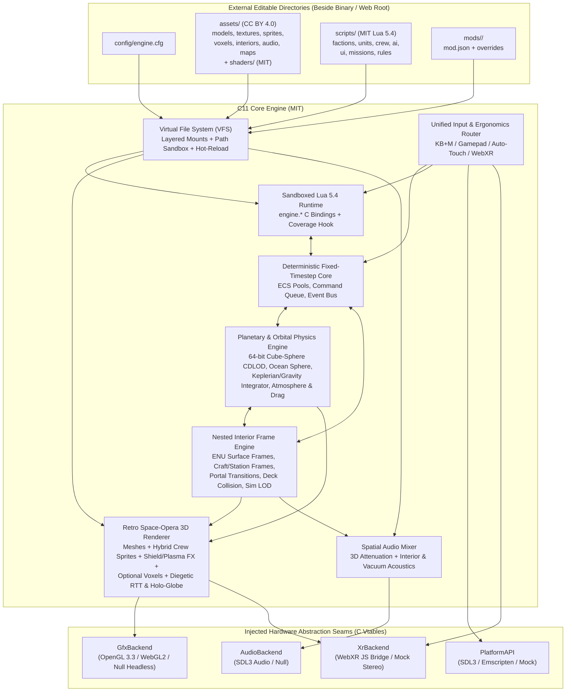
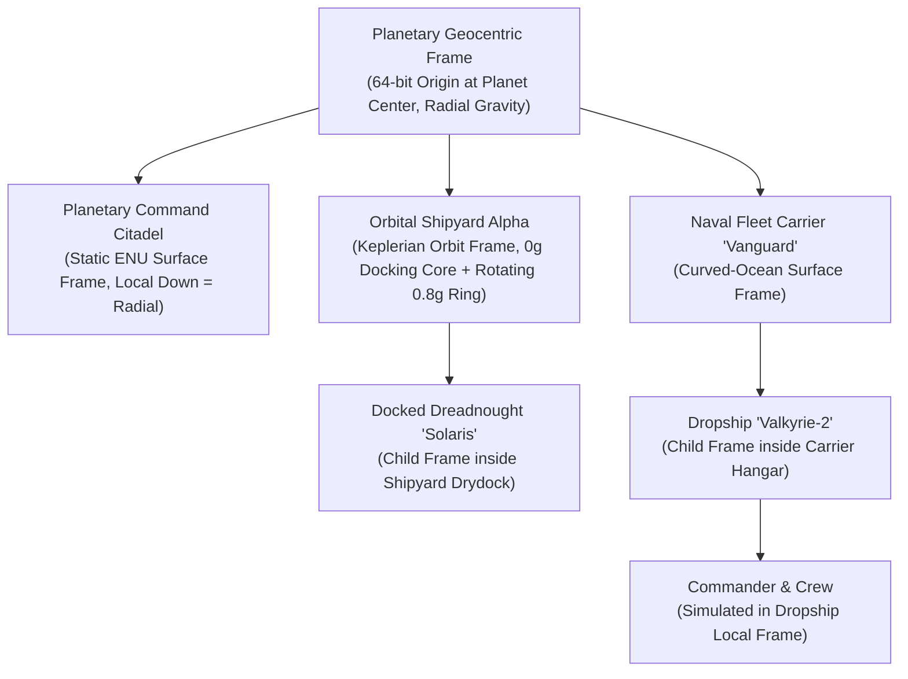
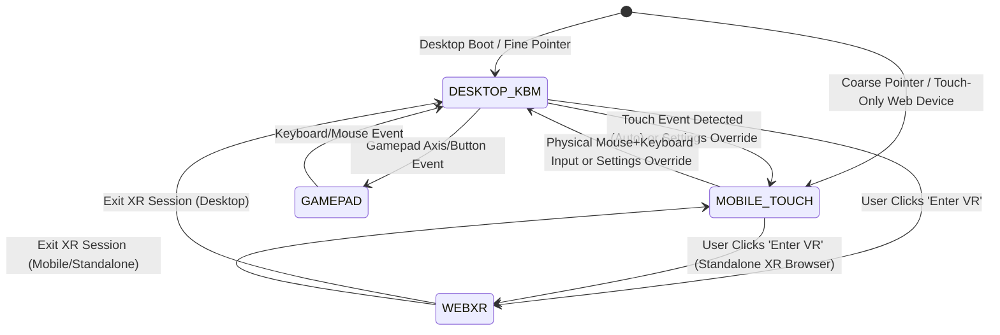

# 1stPRTS (`1prtsg`) — Technical Architecture Blueprint

> **Language:** C11 (Core Engine) + Lua 5.4 (Scripted Gameplay Layer)  
> **Platform & Graphics:** SDL3 + OpenGL (Unified OpenGL 3.3 Core / OpenGL ES 3.0 / WebGL 2.0) + WebXR  
> **World Model:** True-Scale Spherical Planet (Cube-Sphere CDLOD) + Keplerian/N-Body Orbital Mechanics + Nested Interior Frames  
> **Quality Gates:** OpenSpec Spec-Driven Development · >= 95% Unit Test Coverage · Automated End-to-End Game Tests  
> **Asset Policy:** 100% External Assets & Scripts beside the binary (zero baked assets)

---

## 1. Architectural Tenets

1. **Strict Engine / Gameplay Separation:** The C11 core engine handles true-scale spherical planetary geometry, orbital physics, nested 3D interior frames, retro 3D rendering, audio, input, and layered VFS asset loading — it contains **zero hardcoded factions, units, tech trees, weapons, or missions**. All game content and rules (including Hardcore Ironman match rules) live in external Lua 5.4 scripts.
2. **Single Portable Rendering Core:** One OpenGL shader/pipeline core targets **OpenGL 3.3 Core** (Windows, Linux, macOS) and **OpenGL ES 3.0 / WebGL 2.0** (Linux GLES, Emscripten Web, WebXR) via a thin GLSL preamble header — kept behind an injected C vtable (`GfxBackend`) for headless testing and future backends.
3. **True-Scale Planetary-to-Orbital Precision by Construction:** Geocentric 64-bit double-precision coordinates (`Vec3d`), camera-relative floating-origin rendering, local East-North-Up (ENU) surface tangent frames, and **nested local interior reference frames** guarantee sub-millimeter stability from 1m indoor consoles up to 36,000+ km geosynchronous orbits with zero floating-point jitter.
4. **Zero Baked Assets Everywhere:** Desktop mounts sibling directories relative to `SDL_GetBasePath()`. Emscripten Web fetches loose sibling files over relative HTTP into the runtime VFS — never embedding game assets into `.wasm` or monolithic baked blobs.
5. **Deterministic Single-Player Core & >= 95% Testable by Design:** Fixed-timestep simulation plus dependency-injected C vtables (`PlatformAPI`, `GfxBackend`, `AudioBackend`, `XrBackend`, `FsBackend`) keep the door cleanly open for future multiplayer while guaranteeing deterministic headless game tests and >= 95% C + Lua unit test coverage.

---

## 2. High-Level System Architecture



---

## 3. Core Engine (C11) vs. Scripted Game Layer (Lua 5.4)

### Boundary of Responsibilities

| Concern | C11 Core Engine (`src/`) | Lua 5.4 Layer (`scripts/`, `mods/`) |
| :--- | :--- | :--- |
| **Main Loop & Timing** | Fixed-timestep accumulator (60 Hz sim, configurable time-compression multiplier, unlocked render), `emscripten_set_main_loop` / XR loop | Per-tick (`on_tick(dt)`), per-event (`on_event`), match-end rules (Hardcore Ironman Commander death check), UI draw callbacks |
| **Planetary & Orbital** | 64-bit cube-sphere terrain/ocean quadtree, radial gravity, atmospheric density & re-entry heat model, Keplerian orbital elements & burn solver | Planet definitions (radius, mass, atmosphere, biome/height seeds), ship thrust/ISP/shield specs, astrogator AI order planner |
| **Interiors & Spatial** | Nested local reference frames, ENU surface tangent frames, portal/airlock transitions, AABB/OBB/deck collision, raycasting, navgrid pathfinding | Interior deck blueprints, room/door/airlock/escape-pod/console links, artificial gravity & zero-G room definitions |
| **Rendering** | OpenGL/WebGL2 pipeline, floating-origin matrices, mesh/sprite/voxel batching, hybrid 3D/sprite crew LOD, shield dome & plasma shaders, RTT consoles, 3D Holo-Globe, WebXR stereo | Faction liveries, unit visual bindings (mesh, sprite atlas, voxel volume, shield parameters), diegetic CRT & Holo-Globe overlays |
| **RTS Command & AI** | Fast spatial queries, LOS & orbital horizon/visibility checks, sensor grid, deterministic PRNG | Factions, tech trees, build queues, economy/logistics, weapon/shield/subsystem damage math, crew role FSMs, enemy AI commanders |
| **Assets & Modding** | VFS layered mounts, external asset decoders, path-traversal sandbox, hot-reload watcher | `mod.json` registration, overriding/extending unit tables, missions, and rules |
| **Testing** | Hardware mock vtables, C unit tests, `gcov`/`llvm-cov` hooks, headless CLI runner (`--headless --test-script`) | Lua unit tests, Lua line-coverage verification, automated end-to-end game test scenarios |

### Sandboxed Lua Engine API (`engine.*`)

Unsafe host libraries (`io`, `os.execute`, `package.loadlib`, raw `dofile`) are stripped; `require` resolves strictly through the VFS (`mods/` -> `scripts/`).

Planned C-to-Lua namespaces:
- `engine.vfs` — Safe asset/script reads, JSON/config parsing, active mod listing
- `engine.planet` — Query planetary radius, surface height & ocean depth at `(lat, lon)` or 3D unit vector, radial gravity vector, atmospheric density, ENU tangent basis
- `engine.orbit` — Compute Keplerian orbital elements `(a, e, i, Omega, omega, nu)` from state vectors `(r, v)`, sample orbit ellipse points for the 3D Holo-Globe, solve Hohmann / rendezvous burn deltas
- `engine.world` — Spawn/destroy entities, 64-bit geocentric transforms, raycasts, spatial radius queries, horizon/sensor visibility queries
- `engine.interior` — Register deck rooms, portals/airlocks, escape pods, console volumes, gravity zones, atomic entity frame reparenting
- `engine.entity` — Access components (transform, rigidbody, shields, localized hull subsystems, crew roster, cargo, renderable, faction)
- `engine.order` — Dispatch & inspect RTS orders (surface move, naval waypoint, orbital transfer, rendezvous, de-orbit/land, attack, build, board, dock, evacuate)
- `engine.input` — Query unified intent stream, active input mode (`desktop`, `gamepad`, `touch`, `webxr`), ray hits on consoles & Holo-Globes
- `engine.ui` — Immediate-mode retro vector/sprite/text & 3D Holo-Globe projection primitives
- `engine.audio` — Spatial & interior/vacuum acoustic playback
- `engine.xr` — WebXR session state, head/hand poses, controller rays, comfort settings
- `engine.sim` — Deterministic PRNG, tick counter, time-compression scale, state snapshots
- `engine.test` — Test-only synthetic input injection, deterministic tick stepping, assertion & state inspection helpers

---

## 4. True-Scale Spherical Planet, Orbital Mechanics & Nested Interior Architecture

### 4.1 64-Bit Geocentric Coordinates + Camera-Relative Floating Origin
- The world origin `(0, 0, 0)` sits at the **center of the active planet** in 64-bit double precision (`Vec3d`).
- At an Earth-scale radius of 6,371 km ($6.371 \times 10^6$ m) and geosynchronous orbit of 42,164 km ($4.2164 \times 10^7$ m), IEEE-754 `double` retains sub-micrometer precision everywhere in the planetary system.
- Every render frame, visible transforms are computed relative to the camera's 64-bit world position (`obj_world_d - cam_world_d`) and narrowed to 32-bit `float` (`Mat4f`) only for GPU uniform upload.
- Result: zero jitter whether inspecting a bolt on a cockpit dashboard, steering a 340m carrier across a curved ocean, or docking at an orbital shipyard 400 km above the surface.

### 4.2 Cube-Sphere Planetary Terrain & Ocean (CDLOD)
- **Cube-Sphere Projection:** The planetary surface is parameterized as 6 cube faces projected onto the sphere (`spherified cube` mapping to minimize distortion and eliminate polar singularities).
- **Quadtree CDLOD:** Each face subdivides dynamically based on camera altitude — rendering coarse planetary continents from orbit and 1–2m terrain cells right under the Commander's boots, with stitched skirt/morph transitions to prevent T-junction cracks.
- **Ocean Sphere:** A matching spherical water mesh at radius $R_{\text{sea}}$ renders curved retro oceans supporting naval ships, submarines, and amphibious landings seamlessly.
- **Local ENU Surface Frames:** Every planetary building, spaceport, and coastal dock anchors to an **East-North-Up (ENU)** tangent frame computed from its spherical surface normal so interiors remain perfectly level relative to local radial gravity.

### 4.3 Orbital Mechanics & Atmospheric Transition
- **Gravity & Propagation:**
  - Free-flying spacecraft and stations integrate real central-body gravity $\mathbf{a}_g = -\frac{\mu}{\|\mathbf{r}\|^3}\mathbf{r}$ using symplectic / Velocity-Verlet or RK4 integration (with optional Keplerian analytical rail propagation for non-thrusting background stations/satellites to preserve exact long-term orbital stability without drift!).
  - **Keplerian Solver (`src/orbit/`):** Converts `(r, v)` <-> classical orbital elements `(a, e, i, Ω, ω, ν)` in pure C to render crisp glowing orbital tracks on the **3D Planetary Holo-Globe** and compute AI astrogator intercept/transfer burns.
- **Exponential Atmosphere & Shielded Re-entry:**
  - Atmospheric density $\rho(h) = \rho_0 e^{-h / H}$ smoothly drops from sea level to vacuum above the Kármán line.
  - Controls aerodynamic lift/drag for starfighters and dropships, triggers retro plasma re-entry glow & thermal load on shields during high-velocity descent, and modulates exterior sound propagation (full sound in air -> muffled -> silent vacuum in orbit).

### 4.4 Nested Local Reference Frames (Zone Tree)

Every enterable construct owns a `SpatialFrame` node in a strict hierarchy:



- **Local Simulation:** Character movement, deck collisions, ladders, turbolifts, and doors simulate strictly in the occupied construct's local frame — immune to 7.8 km/s orbital velocity or carrier pitch/roll!
- **Portal / Airlock Transitions:** Crossing a ramp, hatch, or docking collar atomically transforms position, velocity, and gravity-up reference between parent and child frames (including smooth zero-G EVA / mag-boot switching on orbital hulls and rotating station rings).
- **Two-Tier Interior Simulation LOD:**
  - **Hydrated Interior:** Full physical rooms, crew pathfinding, doors, consoles, and damage/fire effects inside the Commander's occupied zone, docked neighbors, and active boarding zones.
  - **Abstracted Interior:** Distant ships, stations, and bases track exact crew counts by role, shield/subsystem health, reactor output, and hangar manifests cheaply — deterministically hydrating all crew to their stations the moment the Commander approaches or boards.

---

## 5. External Asset & Mod Virtual File System (VFS)

### Runtime Directory Layout (Beside Binary / Web Root)

```text
<app_root>/
├── 1prtsg (or 1prtsg.exe / index.html + 1prtsg.js + 1prtsg.wasm)
├── config/
│   └── engine.cfg              # Graphics, audio, controls, active mod order
├── assets/                     # Base art/audio (CC BY 4.0) + shaders (MIT)
│   ├── models/                 # Low-poly retro 3D meshes (.obj / compact mesh)
│   ├── textures/               # Pixel-art PNGs + palettes
│   ├── sprites/                # 8-/16-way crew & VFX sprite sheets + JSON atlases
│   ├── voxels/                 # Optional voxel chunks/models (.vox / .vxl)
│   ├── interiors/              # Modular room/deck/portal blueprints
│   ├── audio/                  # SFX & music (.ogg / .wav)
│   ├── shaders/                # External GLSL shaders (MIT)
│   ├── fonts/                  # Retro bitmap fonts
│   └── planets/                # Planet definitions, biome palettes, height seeds
├── scripts/                    # Base gameplay scripts (MIT Lua 5.4)
│   ├── main.lua
│   ├── factions/
│   ├── units/                  # buildings/, vehicles/, ships/, aircraft/, spacecraft/, stations/
│   ├── crew/
│   ├── ai/                     # Strategic, tactical, and orbital astrogator AI
│   ├── ui/                     # Wrist-Pad, CRT consoles, 3D Planetary Holo-Globe
│   ├── rules/                  # Economy, combat/shields, Hardcore Ironman match rules
│   ├── missions/
│   └── tests/                  # Lua unit tests + automated game test scenarios
└── mods/                       # User override packages
    └── example_mod/
        ├── mod.json
        ├── assets/
        └── scripts/
```

### Mount Priority, Security & Web Delivery
- **Layered Resolution:** `mods/<last_enabled>/...` -> `mods/<first_enabled>/...` -> `scripts/` or `assets/`.
- **Path Sandbox:** Rejects leading `/`, drive letters, null bytes, and `..` traversal components.
- **Desktop vs. Emscripten Web:** Desktop resolves relative to `SDL_GetBasePath()` (overridable via `--data-dir`). Emscripten Web fetches loose sibling files via relative HTTP `fetch()` indexed by an external `manifest.json` — **zero embedded assets in `.wasm` or monolithic `--preload-file` archives**, preserving direct server-side modding and asset editing.
- **Hot-Reload:** Runtime reload command refreshes modified Lua scripts, shaders, textures, and unit definitions without restarting.

---

## 6. Retro Space-Opera 3D Graphics Pipeline (SDL3 + OpenGL + WebXR)

### Unified OpenGL 3.3 Core / GLES 3.0 / WebGL 2.0 Shaders
- External GLSL shaders (`assets/shaders/`) share one portable subset; the renderer prepends `#version 330 core` on desktop or `#version 300 es\nprecision highp float;` on GLES3/WebGL2/WebXR.

### Render Passes
1. **Diegetic Render-to-Texture (RTT) Pass:** Draws active in-world screens (Tactical Wrist-Pad, Bridge/Factory CRT consoles) at crisp `GL_NEAREST` retro resolutions.
2. **Primary Scene Pass (Mono on Desktop/Mobile, Dual-View Stereo on WebXR):**
   - **Starfield & Planetary Atmospheric Limb Pass:** Crisp retro stars + smooth altitude-aware sky-to-space atmospheric scattering halo around the spherical planet.
   - **Cube-Sphere Planet & Curved Ocean Pass:** Faceted/pixel-textured retro planetary terrain & animated retro ocean waves.
   - **Portal-Culled Exterior & Interior 3D Meshes:** Batched low-poly hulls, interior rooms, and **close-range 3D crew models** with bold faction tinting, vertex/sector dynamic lighting, and depth/horizon fog.
   - **Optional Greedy-Meshed Voxel Chunks:** Drawn through the exact same mesh pipeline when enabled.
   - **Hybrid Far-Range Crew & VFX Sprite Batcher:** Automatically switches distant/mid-range crew to 8-/16-directional pixel-art billboard sheets based on camera distance (configurable threshold, disabled up close inside interiors & WebXR), alongside plasma flashes, thruster flares, and explosions.
   - **Translucent Space-Opera FX Pass:** Shimmering Fresnel/wireframe **Energy Shield Domes** with impact ripples, plasma/beam trails, atmospheric re-entry plasma glow, and the glowing **3D Planetary & Orbital Holo-Globe** inside War Rooms (miniature rotating planet + live Keplerian orbit rings + unit icons!).
3. **Optional Retro Post-Pass:** Configurable internal resolution scale, subtle Bayer dithering, and palette quantization.
4. **Screen-Space Overlay Pass:** Minimal reticle, radio/alert feed, and **Auto-Touch Virtual Controls** when in `MOBILE_TOUCH` mode.

### WebXR Integration
- Implemented behind `XrBackend` (`src/platform/xr_webxr.c` + `web/xr_bridge.js`).
- Drives `XRSession.requestAnimationFrame`, binds `XRWebGLLayer` framebuffers, executes the Primary Scene Pass for left/right `XRView` matrices, and feeds 6-DOF head/hand poses & controller aim-rays into the Unified Input Router for Holo-Globe manipulation, cockpit controls, and physical Wrist-Pad inspection.

---

## 7. Input Abstraction & Auto-Touch / WebXR State Machine



All modes emit one normalized **Input Intent Stream** (`move_xy`, `look_delta`, `aim_ray`, `interact`, `toggle_pad`, `designate`, `command_wheel`, `holo_select`, `holo_order`, `holo_orbit_zoom`, `mag_boot_eva`) consumed uniformly by C systems, Lua UI, and automated game tests.

---

## 8. Cross-Platform Build & Dependency Matrix

- **Build System:** CMake 3.24+ with `CMakePresets.json` (`linux-debug`, `linux-release`, `linux-coverage`, `linux-asan`, `windows-msvc`, `windows-mingw`, `macos-universal`, `web-emscripten`).
- **Permissive Dependencies Only:**
  - **SDL3** (zlib) — Windowing, GL context, input/touch, audio, base path
  - **Lua 5.4** (MIT) — Embedded gameplay scripting VM
  - **GLAD** (MIT / Public Domain) — Desktop OpenGL 3.3 Core loader
  - **stb_image / stb_vorbis** or **dr_libs** (MIT / Public Domain) — External PNG & audio decoding
  - **cJSON** (MIT) — JSON manifest/atlas/planet parsing
  - **Unity** (MIT) — C11 unit test framework driven via CTest

---

## 9. OpenSpec, >= 95% Unit Coverage & Automated Game Testing

### 9.1 OpenSpec Workflow
Every capability progresses strictly through `openspec/config.yaml` (`spec-driven`):
`proposal.md` -> `specs/<capability>/spec.md` -> `design.md` -> `tasks.md` -> `apply` -> `archive` into `openspec/specs/<capability>/spec.md`.

### 9.2 Engineering for >= 95% Unit Test Coverage
- **Pure C Core Modules (~85–90% of C LOC):** Math (`Vec3d`, `Mat4f`, `Quat`), cube-sphere terrain & ENU frame math, Keplerian orbital mechanics & atmospheric drag, nested interior frame tree & portals, ECS pools, VFS & parsers, greedy voxel mesher, hybrid crew LOD selector, input router, touch geometry, sensor/horizon visibility, and Lua C bindings have **zero SDL/GL calls** and run natively at millisecond speed under CTest.
- **Thin Hardware Vtables (~10–15% of C LOC):** `PlatformAPI`, `GfxBackend`, `AudioBackend`, `XrBackend`, and `FsBackend` are tested against deterministic **Mock/Recording Backends** verifying render batches, shader/error paths, audio zone routing, and WebXR dual-eye matrices.
- **Hard Coverage Gates:**
  - **C Coverage:** `--coverage` (`gcov`/`llvm-cov`) gated via `gcovr --fail-under-line 95` (with branch coverage tracked and reported).
  - **Lua Coverage:** In-process Lua 5.4 `debug.sethook("l")` line-coverage collector asserting **>= 95% line coverage** across `scripts/`.

### 9.3 Automated Game Tests
1. **Tier 1 — Headless Deterministic Simulation Tests (Every Commit & PR):**
   Runs `--headless --data-dir . --test-script scripts/tests/game/<scenario>.lua` using `gfx_null` + `audio_null` + synthetic `engine.test` inputs:
   - `test_citadel_hologlobe_orders.lua`: Commander walks to Citadel War Room -> rotates/zooms 3D Planetary Holo-Globe -> queues Plasma Tank -> confirms physical spawn with 3D crew -> issues move order on curved surface -> verifies arrival.
   - `test_orbital_ascent_and_docking.lua`: Commander boards Dropship on surface -> launches through atmosphere (verifies re-entry/ascent drag & velocity profile) -> enters Keplerian orbit -> docks inside Orbital Shipyard -> crosses airlock portal cleanly into Station frame with zero NaN/clipping.
   - `test_ironman_commander_loss.lua`: Enemy plasma barrage collapses flagship shields and destroys flagship with Commander still aboard -> verifies Hardcore Ironman defeat condition triggers; contrast scenario verifies survival when Commander sprints to Escape Pod and ejects in time.
   - `test_hybrid_crew_lod_and_damage.lua`: Verifies crew renders as 3D meshes inside interiors and switches to directional sprites at range; verifies engine-room hit reduces thrust until AI engineer repairs it.
   - `test_mobile_touch_hologlobe.lua`: Activates `MOBILE_TOUCH` mode -> feeds synthetic thumbstick, look-drag, and two-finger Holo-Globe pinch/tap -> verifies unit selection & order execution.
   - `test_webxr_stereo_hologlobe.lua`: Activates mock `XrBackend` -> verifies dual-eye stereo projection & controller aim-ray issuing orbital fleet orders on the Holo-Globe.
   - `test_mod_override_vfs.lua`: Mounts a sample mod -> verifies Lua unit rules and external assets override base files without modifying base folders.
2. **Tier 2 — Offscreen GPU & Browser WebGL2 / WebXR Smoke Tests (CI):**
   - **Native Offscreen OpenGL:** Mesa llvmpipe / EGL / xvfb renders live frames under `ASan`/`UBSan` asserting zero `glGetError()` faults and non-blank framebuffers.
   - **Emscripten Web + Mobile Touch + WebXR:** Serves loose external `assets/` and `scripts/` over local HTTP to headless Chromium (Playwright), confirming zero baked blobs, auto-touch switching on mobile viewport emulation, WebXR bridge readiness, and zero console/WASM errors.
