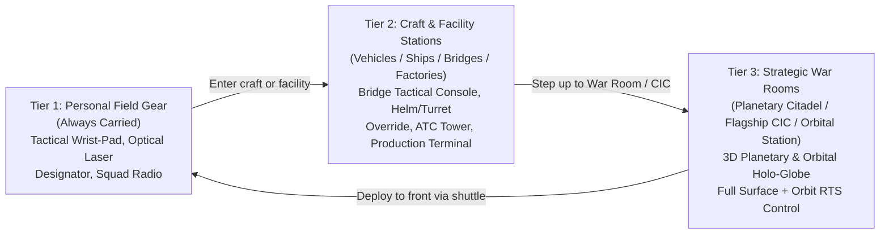
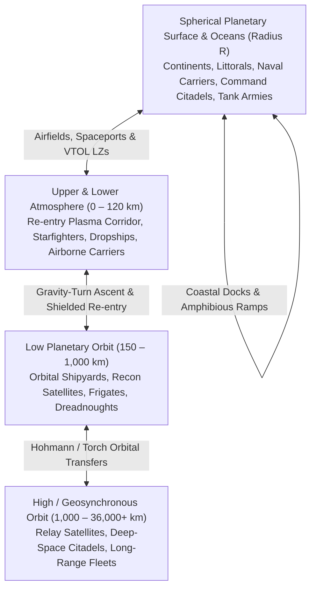

# 1stPRTS (`1prtsg`) — Game Concept & Design Bible

> **Working Title:** 1stPRTS (`1prtsg`)  
> **Genre:** Exclusively First-Person Real-Time Strategy (1st-Person RTS) & Orbital-to-Surface Tactical Simulation  
> **Setting & Aesthetic:** Classic Bold-Color Retro Space-Opera 3D (Low-Poly 3D Meshes + Hybrid Directional Sprites + Optional Voxels)  
> **World Scale:** True-Scale Spherical Planets with Real Orbital Mechanics  
> **Commander Stakes:** Hardcore Ironman (Commander Death Ends the Match)  
> **Engine:** C11 Core Engine (`SDL3` + `OpenGL` / `WebGL 2` / `WebXR`) + Moddable `Lua 5.4` Gameplay Layer

---

## 1. Executive Vision & Core Fantasy

**1stPRTS** collapses the divide between **planetary-to-orbital Real-Time Strategy** and **immersive 1:1 First-Person Presence** inside a vibrant, classic retro space-opera universe.

You are never a floating invisible camera hovering above toy-sized units. You are **the physical Commander** standing in boots on gleaming starship decks and planetary fortresses — and **your life is the match**:

- You step onto the observation gantry of your **Planetary Command Citadel** as bold-liveried plasma artillery batteries and shimmering dome shields repel an orbital landing wave across the coastal horizon.
- You walk into the **War Room**, stand before a glowing **3D Planetary & Orbital Holo-Globe**, spin the sphere, trace real Keplerian orbital tracks of enemy cruisers passing overhead, and direct surface armor divisions, naval carrier groups, interceptor wings, and orbital frigates — **without ever leaving your own eyes**.
- You board an angular **Dropship** inside the hangar bay, watch your crew seal the boarding ramp, launch smoothly through the atmosphere with plasma shields glowing against re-entry/ascent heat, burn into a true equatorial orbit, dock inside a **2-kilometer Orbital Shipyard**, and step out onto the deck to inspect your new 650-meter Dreadnought.
- If enemy rail-torpedoes overload your flagship's shields and breach the reactor core, the alarms blare and deck lights strobe crimson: **Hardcore Ironman rules apply** — if you go down with the ship, the war is lost. You must physically sprint through smoking corridors with your marine escort to an emergency shuttle or escape pod and live to fight on!

### The Five Design Pillars

1. **Never Break First-Person:** Every strategic, orbital, tactical, logistical, and direct-combat interaction happens physically through the Commander's eyes, hands, field gear, or in-world consoles and holo-globes.
2. **True 1:1 Colossal Scale on True Spherical Worlds:** Every building, ground vehicle, naval ship, aircraft, spacecraft, and space station is realistically huge relative to a 1.8m human, fully enterable and explorable, set across a **full true-scale spherical planet with authentic orbital mechanics**.
3. **Manned & Living Machines:** Crews physically pilot helms, fire plasma batteries, maintain shield generators, run damage control, and conduct deck-by-deck boarding actions.
4. **Classic Retro Space-Opera 3D:** High-contrast bold faction liveries, sleek angular starfighters and capital ships, shimmering energy shield domes, glowing plasma/beam fire, nearest-neighbor pixel textures, **hybrid 3D-close / directional-sprite-far crew**, and optional chunked voxels.
5. **Radically Open & Moddable:** Zero baked assets. Every faction, ship deck layout, weapon, orbital map, AI commander, texture, 3D model, sprite sheet, sound, and Lua script sits in plain folders beside the binary.

---

## 2. Setting & Aesthetic Identity: Classic Bold-Color Retro Space-Opera

Inspired by golden-age 3D space-opera & tactical classics (*TIE Fighter*, *Homeworld*, *Star Wars: Dark Forces II*, *Descent*, *Battlezone '98*, *Colony Wars*):

- **Bold Visual Silhouettes & Primary Faction Liveries:** Crisp angular armor hulls, sweeping fighter wings, gleaming tower bridges, and unmistakable faction color schemes (e.g., **Solar Directorate** in cobalt blue, white & gold vs. **Crimson Dominion** in crimson red, obsidian & amber) that stay readable across kilometers of ocean or orbital space.
- **Energy Shields & High-Energy Weapons:**
  - Major bases, capital ships, naval carriers, and elite craft project shimmering translucent **Energy Shield Domes / Hull Deflectors** with directional retro impact ripples when struck.
  - Combat combines rapid **plasma bolts**, continuous **beam lances**, **homing torpedoes/missiles**, **kinetic point-defense flak**, and **orbital bombardment cannons**.
- **Hybrid Retro 3D Rendering Primitives:**
  1. **Low-Poly 3D Objects:** Sharp-edged retro meshes with `GL_NEAREST` pixel-art textures, per-vertex/Gouraud + sector dynamic lighting, atmospheric limb glow, and optional ordered Bayer dithering.
  2. **Hybrid Crew & Multi-Directional Sprites:** Crew and infantry render as **low-poly retro 3D models up close** inside interiors and in WebXR (preserving depth, tools, weapons, and gestures) and seamlessly transition to crisp **8-/16-directional pixel sprites** at medium/far battlefield distances for massive army/fleet performance. Sprites also power plasma flashes, shield sparks, engine flares, explosions, and tactical icons.
  3. **Optional Chunked Voxels:** An optional engine module (`voxel`) supports destructible craters, asteroid chunks, modular interior bulkheads, and rapid modder prototyping, greedy-meshed into the same OpenGL pipeline.
- **Diegetic UI & Retro Spatial Audio:**
  - Glowing wireframe CRT consoles, holographic star-charts, physical throttle levers, shield-arc gauges, and minimal HUD chrome.
  - Spatial audio with interior acoustic muffling (armored hull dampening, echoing hangar bays, thruster hum near reactor decks, radio comms squelch, and silent vacuum outside space stations except hull-conducted vibration).

---

## 3. The Commander's Toolkit: How First-Person RTS Works

1stPRTS eliminates command friction without ever resorting to a god-camera via a **three-tier diegetic command hierarchy**:

### Tier 1 — Personal Field Gear (Always On Your Person)

1. **Tactical Wrist-Pad:** Physically raised into view (mounted on your wrist in WebXR; compact touch drawer on mobile). Shows local topographic/orbital map, unit/fleet roster, shield & reactor alerts, resource ledgers, and production queues — constrained by active **sensor coverage and comms relay links**.
2. **Optical Binoculars & Laser Designator:** Magnified rangefinder optics to paint targets, landing zones, artillery coordinates, or construction beacons directly in 3D space across land, sea, or sky.
3. **Command Radio & Quick Order Wheel:** Context-sensitive radial command menu aimed at any unit, crew member, or formation (`Escort Commander`, `Move / Orbit`, `Engage Target`, `Board / Disembark`, `Dock / Rearm`, `Patrol`, `Emergency Evac`).

### Tier 2 — Local Command Stations (Bridges, Cockpits & Facilities)

- **Bridge & CIC Stations:** Stand behind your helmsman and tactical officers watching live battles through armored viewports while issuing fleet/squadron orders via the bridge tactical table.
- **Direct Manual Override:** Sit in *any* pilot seat, tank cupola, helm, or plasma turret to take direct first-person control at any time — stand up to hand control seamlessly back to AI crew.
- **Flight Deck & Factory Consoles:** Launch interceptor squadrons from ATC towers; queue tanks, ships, and capital hulls at factory and orbital drydock consoles while watching them assemble at 1:1 scale on the floor/gantry below.

### Tier 3 — Strategic War Rooms: The 3D Planetary & Orbital Holo-Globe

Inside your **Planetary Command Citadel**, **Capital Carrier/Dreadnought CIC**, and **Orbital Command Station**, you walk up to a room-sized glowing **3D Planetary & Orbital Holo-Globe**:

- Displays the entire spherical planet (continents, oceans, bases, weather/atmosphere) surrounded by real-time **3D Keplerian orbital rings** for every satellite, spacecraft, and space station.
- Walk around the globe, spin it, zoom seamlessly from planetary orbital trajectories down to a single coastal harbor or fortress ridge, drag-select armies/fleets (with mouse, touch pinch/tap, or WebXR hand-rays), plot orbital transfer burns, place base blueprints, and assign supply convoys — **100% in first person**.

### Information Realism: Fog of War & Comms Relays

- **True Sensors:** Tactical overlays display only contacts detected by friendly radar/optics, sonar, recon fighters, or **orbital recon satellites** currently passing over a hemisphere!
- **Comms Relay Network:** Global planetary-to-orbital command depends on **Comms Towers, Relay Ships, and Geosynchronous / Low-Orbit Relay Satellites**. Knocking out an enemy's orbital relay constellation blinds their commanders across the far side of the planet!

---

## 4. Realistically Huge, Manned & Enterable Everything

Every construct across all **six asset classes** is built to **1:1 human scale** (1 unit = 1 meter, Commander eye height ≈ 1.7m), staffed by crew, and traversable inside and out:

| Scale Class | Representative Units | Approx. Scale (L × W × H) | Crew Complement | Key Enterable Spaces |
| :--- | :--- | :--- | :--- | :--- |
| **1. Buildings** | Command Citadel, Fusion Plant, Ore Refinery, Vehicle Foundry, Starfighter Hangar, Shield Generator, Plasma Turret Silo, Spaceport | 18m – 220m | 4 – 60 | War Room (3D Holo-Globe), Comms Hub, Fusion Reactor Core, Assembly Hall w/ Gantries, Shield Capacitor Room, Barracks, ATC Tower, Launch Apron |
| **2. Ground Vehicles** | Recon Skimmer/Jeep, Armored Personnel Carrier, Plasma Heavy Tank, Mobile Command Landship | 6m – 70m | 2 – 30 | Open Cab / Walkable Troop Bay w/ Ramp, Tank Hull & Commander Cupola, Multi-Deck Landship Bridge + Mini-Hangar + Shield Core |
| **3. Naval Ships** | Fast Missile Boat, Plasma Destroyer, Attack Submarine, Fleet Aircraft/Starfighter Carrier | 30m – 340m | 6 – 120+ | Pilothouse / Bridge, CIC Holo-Globe, Flight Deck, Island Control Tower, Sub-Deck Hangar & Lifts, Sonar/Torpedo Bay, Reactor Room, Crew Quarters |
| **4. Aircraft** | Sleek Angular Starfighter/Interceptor, Troop/Cargo Dropship, Heavy Plasma Gunship, Airborne Command Carrier | 15m – 165m | 1 – 45 | Enterable Fighter Cockpit (ladder & canopy), Walkable Dropship Cargo/Troop Bay w/ Rear Ramp, Gunship Turret Deck, Airborne Carrier Hangar & Bridge |
| **5. Spacecraft** | Orbital Shuttle, Shielded Corvette, Orbital Frigate, Battlecruiser, Capital Carrier / Dreadnought | 24m – 650m | 2 – 150+ | Airlocks, Bridge & CIC Holo-Globe, Pressurized Hangar Bays (holding fighters/shuttles), Reactor & Shield Core, Gun Decks, Escape Pod Bays, Engineering Corridors |
| **6. Space Stations** | Orbital Relay/Defense Satellite, Orbital Fuel Depot, Orbital Shipyard Drydock, Deep-Space Command Citadel | 120m – 2,200m+ | 20 – 300+ | Docking Bays w/ Containment Fields, Internal Monorail/Lift Spine, Open Drydock Gantries (1:1 capital ship construction), Orbital War Room Citadel, Rotating Gravity Ring + Zero-G Core |

### Playable Colossal Interiors
- **Zero Empty Filler:** Every room ties to an operational system (Bridge, CIC, Reactor, Shield Core, Hangar, Turret Control, Airlock, Escape Pods, Medbay, Armory).
- **Clear Wayfinding & Fast Transit:** Bold color-coded retro deck stripes, wall deck-maps, rapid turbolifts, and internal tramways in kilometer-scale stations keep navigation snappy.
- **Interior–Exterior Continuity:** Armored bridge windows, hangar containment fields, and observation decks look directly out at the spinning planet, orbiting fleets, and plasma battles outside.

---

## 5. Living Crew, Localized Subsystems, Boarding & Hardcore Ironman Stakes

### Simulated Crew Roles
- **Pilots, Astrogators & Helmsmen:** Steer vehicles, execute atmospheric ascents, calculate and burn orbital transfers/rendezvous, and hold fleet formations automatically on order.
- **Gunners & Shield Officers:** Track targets, balance shield arcs, and fire plasma/beam/torpedo batteries.
- **Sensor & Comms Officers:** Operate radar, orbital scanners, and comms links; call out incoming bogeys, shield collapse, and hull breaches over intercom.
- **Engineers & Damage Control:** Maintain reactors and shields; physically rush with repair welders and extinguishers to damaged decks.
- **Marines & Boarding Squads:** Guard the Commander, defend bridges/reactors, deploy from dropships, and storm enemy structures, ships, and space stations deck-by-deck.

### Localized Subsystem Damage & Boarding
- **Shields First, Then Spatial Hull Damage:** Energy shields absorb incoming plasma/beam hits until depleted (or bypassed by close-range boarding craft slipping inside a shield dome!). Once shields fail, hits damage the exact physical compartment struck (e.g., Engine Bay -> reduced thrust; Shield Core -> shields offline; Bridge -> loss of local command console; Airlock/Hull -> decompression requiring suit mag-boots & visor).
- **Capture Intact Capital Assets:** Boarding marines can fly dropships into an enemy carrier's hangar or breach an orbital station airlock to capture the Bridge and seize the entire vessel intact.

### Hardcore Ironman Commander Rules (Default Match Rule)
- **One Life — Total Strategic Tension:** If the Commander is killed (whether on the ground, inside a collapsing bunker, or aboard an exploding flagship), **the match ends immediately in defeat**.
- **Fair, Dramatic Survival Mechanics:**
  - The Commander wears a personal **Tactical Exo-Suit** (personal deflector shield + EVA thruster pack + mag-boots + vacuum visor) to survive stray fire and emergency spacewalks.
  - Every capital ship, station, and bunker features **physical Escape Pod Bays, Emergency Shuttles, and Armored Panic Citadels**, plus early critical-hull / reactor-meltdown alarms (e.g., 30–60 seconds of roaring klaxons and flickering lights) giving you a heart-pounding window to run to an escape pod, launch to safety, and call a pickup shuttle!
  - Because match rules live in Lua (`scripts/rules/`), modders or custom skirmish presets can optionally toggle alternate rules, while **Hardcore Ironman** is the official signature game mode.

---

## 6. True-Scale Spherical Planet & Real Orbital Mechanics

The entire battlefield is a **full true-scale spherical planet** (e.g., configurable planetary radius from 1,700 km moons up to 6,371 km Earth-scale worlds, complete with oceans, continents, mountain ranges, and an atmospheric shell extending seamlessly into orbital space).

### How True Orbital Mechanics Stay Fun & Strategic
1. **Authentic Physics, Space-Opera Drives:** Spacecraft and Space Stations follow real central-body gravity ($\mathbf{a} = -\mu \mathbf{r}/r^3$), real orbital velocity, inclination, apoapsis/periapsis, and continuous orbital motion — meaning a station in a 400 km orbit genuinely circles the planet and crosses over ground bases on real orbital windows!
2. **AI Astrogators Handle the Math:** From the **3D Planetary Holo-Globe** or Bridge console, you issue intuitive orders (*"Establish 350 km Polar Recon Orbit,"* *"Rendezvous with Shipyard Alpha,"* *"De-orbit & Land at Coastal Base Beta"*). Your Lua/C astrogation autopilot plans and executes the orbital burn cleanly — while manual pilots can still fly raw burns from the cockpit!
3. **High-Thrust Torch Drives & Single-Player Time Compression:** Classic space-opera fusion drives keep orbital transfers crisp and responsive rather than multi-hour waits, complemented by configurable **Single-Player Time Compression** (e.g., `1x` / `2x` / `4x` / `8x` when safe out of combat) and fast personal courier shuttles so you never endure dead transit time.
4. **Atmospheric Transition & Shielded Re-entry:** Descending from orbit builds aerodynamic drag and glowing retro plasma friction across your hull/shields, seamlessly transitioning from vacuum thruster flight to atmospheric lift as continents, cloud layers, oceans, and coastal bases resolve beneath you.

### Core Economy & Game Modes (Single-Player First)
- **Physical Logistics Loop (Lua-Defined):** `Ore / Crystal` (planetary mines & orbital asteroids) + `Fusion Fuel` (refineries & orbital depots) + `Power & Crew Manpower` (fusion plants & barracks/habitats) hauled physically by convoys and orbital cargo lifters.
- **Single-Player Focus (Deterministic Core):**
  - **Skirmish vs. Lua AI Commanders** (configurable planetary & orbital theater scope)
  - **Sandbox / Free-Explore** (spawn and explore all 6 scale classes, test orbital burns, showcase WebXR)
  - **Tactical Scenarios** (e.g., *Orbital Drop Defense*, *Carrier Strike*, *Escape the Flagship*, *Drydock Boarding*)
  - Built on a **deterministic fixed-timestep core** so LAN/WebRTC multiplayer can be layered on cleanly in a future milestone.

---

## 7. Cross-Platform Ergonomics (Desktop, Mobile Web Touch & WebXR)

All input devices emit into one unified **Intent Layer** in C:

- **Desktop (Windows, Linux, macOS, Desktop Web):** `WASD` + Mouse look, `E` interact/enter seat/console, `Tab` Tactical Wrist-Pad, `Q` Laser Designator, `R`/Right-Click Command Wheel, `Space` jump / EVA thrusters / mag-boots, `Shift` sprint, plus full mouse interaction on 3D Holo-Globes and optional Gamepad support.
- **Mobile Web (Auto-Touch Switching):** Automatically detects touch/coarse-pointer devices (`pointer: coarse`, `maxTouchPoints > 0`, SDL3 touch events) and activates an ergonomic **Touch HUD** (manual toggle in Settings):
  - Left floating virtual thumbstick (move/throttle) + right touch-drag look region.
  - Compact action cluster (`Interact`, `Wrist-Pad`, `Designator`, `Command Wheel`, `Mag-Boot/EVA`).
  - Direct **one-finger tap** select, **two-finger drag/pinch** rotate & zoom on the 3D Planetary Holo-Globe and Wrist-Pad!
- **WebXR (6-DOF VR via Emscripten + WebGL 2):**
  - Stereoscopic 1:1 true-scale presence (stand under a 340m carrier or lean directly over a floating 3D Planetary Holo-Globe with orbiting ships circling around your shoulders!).
  - Left wrist physically displays the Tactical Wrist-Pad; right controller ray selects units on the Holo-Globe, paints horizon targets, and flips physical cockpit/bridge switches.
  - Comfort options: snap/smooth turn, seated cockpit mode, peripheral flight vignette, and zero-G orientation lock.

---

## 8. Extensibility, Modding & Dual Licensing

- **Zero Baked Assets:** Executables and `.wasm` binaries contain only the C11 core engine. All models, textures, sprites, voxels, shaders, audio, orbital maps, and Lua scripts live in plain external directories (`assets/`, `scripts/`, `mods/`, `config/`) beside the binary (and as loose relative HTTP files on Web).
- **Layered Mod System (`mods/<mod_id>/`):** Drop-in mod folders with `mod.json` override or extend any asset or Lua script, with runtime **hot-reload**.
- **Dual Licensing:**
  - **MIT License** ([`LICENSE-CODE`](../LICENSE-CODE)) for all C code, Lua scripts, shaders, build files, tests, and docs.
  - **CC BY 4.0** ([`LICENSE-ART`](../LICENSE-ART)) for all art and audio assets.

---

## 9. Phased Vertical-Slice Roadmap

Every phase is executed via **OpenSpec** (`proposal` -> `specs` -> `design` -> `tasks` -> `apply` -> `archive`), enforcing **>= 95% unit test coverage** (C + Lua) and **automated game tests** at every milestone:

| Phase | Milestone Name | Key Deliverables |
| :--- | :--- | :--- |
| **Phase 0** | **Concept, Architecture & OpenSpec Setup** | Finalized `CONCEPT.md`, `ARCHITECTURE.md`, dual licenses, OpenSpec config, and locked-in design decisions. *(Complete)* |
| **Phase 1** | **Engine Core & Planetary Vertical Slice ("Citadel & Dropship")** | Cross-platform CMake build (Win/Linux/Mac/Emscripten), VFS external asset loader, sandboxed Lua 5.4 VM, retro space-opera OpenGL/WebGL2 renderer (meshes + hybrid crew sprites + shields/plasma), **64-bit true-scale cube-sphere planet + ENU local surface frames + nested interior frames**, enterable **Planetary Command Citadel** (with interactive 3D Planetary Holo-Globe), enterable **Dropship** (walkable bay + AI pilot + manual override), enterable **Plasma Tank**, Hardcore Ironman Commander death/escape-pod rule, auto-touch mobile UI, >= 95% C+Lua unit coverage, and headless + browser automated game tests. |
| **Phase 2** | **Combined Arms & True Orbital Ascension** | Full **Keplerian orbital mechanics**, atmospheric drag & shielded re-entry, AI astrogator orbital transfer burns, enterable **Orbital Shuttle**, **Frigate**, and **Orbital Shipyard Space Station** (rotating gravity ring + zero-G docking core), enterable Vehicle Foundry, Fusion Plant, Refinery, Naval Destroyer & Carrier, Starfighters, orbital recon/comms relay fog-of-war, localized subsystem damage & crew repair, Lua AI Commander, and optional Voxel module. |
| **Phase 3** | **Capital Fleet Warfare, Boarding & WebXR** | Enterable 650m **Capital Carrier / Dreadnought**, multi-deck boarding & capture gameplay, emergency evacuation sequences, full stereoscopic **6-DOF WebXR** support (Holo-Globe hand-rays, physical wrist-pad, cockpit VR), and planetary-to-orbital skirmish & scenario suite. |
| **Phase 4** | **Mod SDK, Audio Acoustics & Release Packaging** | Hot-reload modder SDK & sample mod, interior/vacuum spatial audio polish, performance profiling across all 5 platforms, and automated cross-platform CI release builds. |

---

## 10. Confirmed Design Decisions

All foundational concept choices have been finalized prior to Phase 1 OpenSpec drafting:

| # | Decision Area | Confirmed Choice | Impact |
| :--- | :--- | :--- | :--- |
| **1** | **Setting & Aesthetic** | **Classic Bold-Color Retro Space-Opera** | Bold faction liveries, energy shield domes, plasma/beam/torpedo weapons, sleek angular starfighters & capital ships. |
| **2** | **Commander Death Rule** | **Hardcore Ironman** | Commander death ends the match immediately; puts strong emphasis on personal exo-suit survival, shielded bridges, and sprinting to physical escape pods/shuttles (Lua-moddable for custom presets). |
| **3** | **Planet & Space Scale** | **True-Scale Spherical Planet + Orbital Mechanics** | 64-bit cube-sphere planet, ENU local surface frames, real central-body gravity & Keplerian orbits, 3D Planetary & Orbital Holo-Globe in War Rooms, shielded re-entry, AI astrogator burn planning. |
| **4** | **Multiplayer Scope** | **Single-Player First (Deterministic Core)** | Skirmish vs. Lua AI, Sandbox, and Scenarios first; fixed-timestep deterministic simulation keeps future LAN/WebRTC multiplayer cleanly achievable. |
| **5** | **Crew Visual Style** | **Hybrid (3D Up Close / Directional Sprites at Range)** | Low-poly retro 3D models inside interiors and in WebXR, seamlessly switching to 8-/16-directional pixel sprites at medium/far battlefield distances. |
