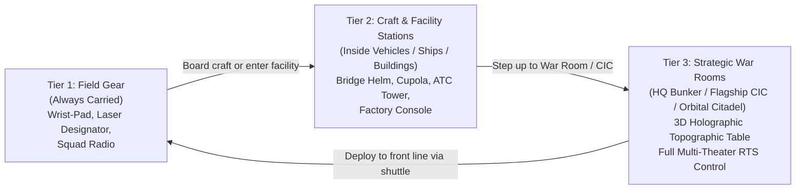
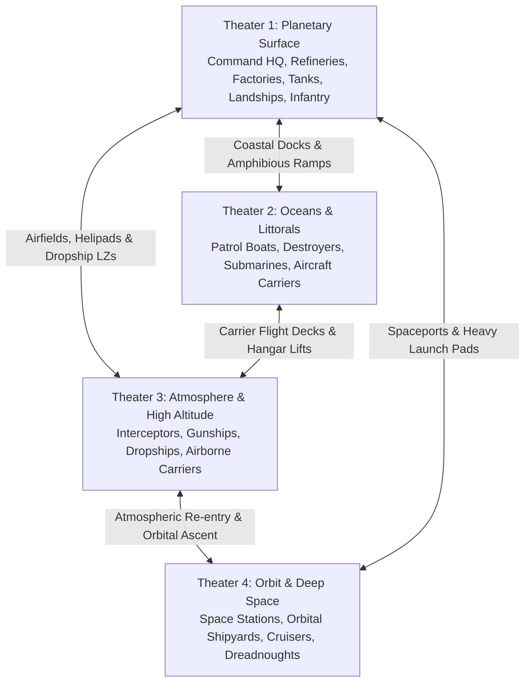

# 1stPRTS (`1prtsg`) — Game Concept & Design Bible

> **Working Title:** 1stPRTS (`1prtsg`)  
> **Genre:** Exclusively First-Person Real-Time Strategy (1st-Person RTS) & Tactical Simulation  
> **Aesthetic:** Late-90s / Early-2000s Retro 3D (Low-Poly 3D Meshes + Multi-Angle Sprites + Optional Voxels)  
> **Engine:** C11 Core Engine (`SDL3` + `OpenGL` / `WebGL 2` / `WebXR`) + Moddable `Lua 5.4` Gameplay Layer

---

## 1. Executive Vision & Core Fantasy

**1stPRTS** collapses the divide between **grand-scale Real-Time Strategy** and **immersive 1:1 First-Person Presence**.

You are never a floating invisible camera hovering 300 meters above toy-sized tanks. You are **the physical Commander** standing in boots on steel decking:

- You step out of your Command Bunker onto a windswept ridge, raise your laser designator, and paint an enemy radar bunker while your heavy armor column rolls past you — each tank towering over your head.
- You walk into the Heavy Vehicle Factory, hear the gantry cranes echoing across the cavernous assembly hall, inspect a half-welded tank hull on the floor, and queue two more brigades from the floor foreman's CRT terminal.
- You duck into the War Room, lean over a glowing 3D holographic topographic table, and coordinate a combined-arms naval carrier strike and dropship assault across a 40-kilometer theater — **all without ever leaving your own eyes**.
- You board a troop dropship parked on the tarmac, tell the pilot *"Take us up to Orbital Shipyard Alpha,"* strap in (or walk down the cargo bay checking on the marine squad), watch the rear ramp seal, lift through the cloud layer into black space, fly through the pressurized hangar field of a 2-kilometer orbital drydock, and step out onto the observation catwalk overlooking a 600-meter dreadnought under construction.

### The Five Design Pillars

1. **Never Break First-Person:** Every strategic, tactical, logistical, and direct-combat interaction happens physically through the Commander's eyes, hands, gear, or in-world consoles.
2. **True 1:1 Colossal Scale:** Buildings, vehicles, naval ships, aircraft, spacecraft, and space stations are realistically massive relative to a 1.8m human — and **every single one can be entered, walked through, and operated**.
3. **Manned & Living Machines:** Nothing is an autonomous empty shell. Crews sit at helms, load guns, walk corridors, weld hull breaches, salute as you pass, and degrade a craft's performance when injured or killed.
4. **Crisp Retro 3D Readability:** Chunky silhouettes, nearest-neighbor pixel textures, multi-directional sprites, optional voxel blocks, and high-contrast diegetic CRT UI deliver extraordinary visual clarity at both 2 meters and 20 kilometers — while running smoothly on desktop, mobile Web, and WebXR.
5. **Radically Open & Moddable:** Zero baked assets. Every unit stat, ship deck layout, AI doctrine, mission, texture, 3D model, sprite sheet, sound, and Lua script sits in plain folders alongside the binary, designed from day one to be inspected, remixed, and extended.

---

## 2. The Commander's Toolkit: How First-Person RTS Works

The central design challenge of an exclusively first-person RTS is **command friction**: how do you manage dozens of units across land, sea, air, and orbit from one pair of human eyes without feeling blind or overwhelmed?

1stPRTS solves this with a **three-tier diegetic command hierarchy** where better command facilities unlock richer situational awareness and control — making your physical location a meaningful strategic choice!

### Tier 1 — Personal Field Gear (Always On Your Person)

1. **Tactical Wrist-Pad / Field Datapad:**
   - Raised physically into the Commander's left/center view (held in hand in WebXR; sleek slide-up panel on mobile touch).
   - Displays a crisp retro vector/topographic 2D tactical map, active unit/squad roster, resource counters, production queue overview, and incoming crew alerts.
   - Limited by **local radio range and active comms relay links** — if you are deep inside an enemy-jammed valley with no relay overhead, your wrist-pad shows stale last-known contacts with static distortion.
2. **Optical Binoculars & Laser Designator:**
   - Look through magnified retro rangefinder optics at real terrain, ships, or enemy fortifications kilometers away.
   - Paint targets directly in 3D space to issue instant contextual orders: *"Move Squad Bravo here,"* *"Focus artillery on painted coordinates,"* *"Construct Forward Turret at beacon,"* or *"Dropship 2, land at smoke flare."*
3. **Command Radio & Quick Order Wheel:**
   - Point at any friendly unit, crew member, or squad banner and tap the Command key/button to open a fast radial wheel: `Follow / Escort`, `Hold / Defend`, `Assault`, `Board / Disembark`, `Dock / Resupply`, `Patrol`, `Repair`.

### Tier 2 — Local Command Stations (Inside Vehicles, Ships, Aircraft & Buildings)

Walking up to physical consoles inside structures and vessels unlocks specialized roles:

- **Bridge / CIC Command Chair (Naval & Spacecraft):** Stand or sit at the central tactical display with wrap-around armored viewports looking out over the battlefield or fleet. Issue squadron/fleet orders via the bridge console while watching your helmsman and weapons officers execute them around you.
- **Direct Override Stations (Helm, Pilot Seat, Gunner Turret):** Take manual first-person control of *any* unit at any time — drive a tank, fly an interceptor, steer a destroyer, or fire a point-defense cannon — and hand control seamlessly back to your AI crew the instant you stand up.
- **Air Traffic Control / Flight Deck Tower:** Manage takeoff/landing queues, scramble interceptor wings, and inspect hangar rearming status while watching aircraft launch literally beneath the tower glass.
- **Factory / Refinery / Shipyard Terminals:** Queue production lines, prioritize hull repairs, allocate power between shields/manufacturing/sensors, and watch assembly gantries build units in real time on the bay floor.

### Tier 3 — Strategic War Rooms (3D Holographic Topographic Tables)

Located inside your **Command HQ Bunker**, **Aircraft Carrier / Dreadnought CIC**, and **Orbital Command Citadel**:

- You physically walk up to a massive waist-high **3D Holographic / Wireframe Tactical Table** projecting the live terrain, ocean, airspace, and orbital layers above it in crisp glowing retro-3D geometry.
- **Zero camera break:** You walk around the table, lean in to zoom on a contested harbor, pan the projection across theaters, drag-box select battalions/fleets on the table surface (with mouse, touch gestures, or WebXR hand-rays!), place building blueprints, and set multi-waypoint supply routes.
- **Tactical vulnerability & drama:** If enemy bombers strike your HQ while you are at the War Room table, the lights flicker red, alarms wail, blast doors slam shut, and dust falls from the ceiling — you are *really there*.

### Information Realism: Sensors, Fog of War & Comms Relays

- **True Line-of-Sight & Sensor Cones:** Your tactical maps only show what friendly optics, radar dishes, sonar buoys, recon scouts, or orbital satellites can physically detect.
- **Comms Relay Network:** Command signals travel from HQ / Flagships through **Comms Towers, Relay Aircraft, and Orbital Satellites**. Units outside comms range continue executing their last standing orders autonomously (using Lua tactical AI) until contact is restored — or until you physically ride out to them!

---

## 3. Realistically Huge, Manned & Enterable Everything

Every single construct across all **six asset classes** is built to **1:1 human scale** (1 unit = 1 meter, Commander eye height ≈ 1.7m), manned by crew, and designed with traversable interior decks connected to the outside world through doors, ramps, hatches, elevators, and docking airlocks.

| Scale Class | Representative Units | Approx. Scale (L × W × H) | Crew Complement | Key Enterable Spaces |
| :--- | :--- | :--- | :--- | :--- |
| **1. Buildings** | Command HQ, Power Plant, Refinery, Vehicle Factory, Hangar, Defense Bunker, Spaceport | 15m – 180m | 4 – 60 | War Room (Holo-Table), Comms Room, Reactor Hall, Assembly Bay w/ Gantry Cranes, Barracks, Armory, Turret Loader Room, ATC Tower |
| **2. Ground Vehicles** | Recon Jeep, APC, Heavy Tank, Mobile Command Crawler (Landship) | 5m – 65m | 2 – 28 | Open Cab / Troop Bay w/ Rear Ramp, Tight Tank Hull & Turret Cupola, Multi-Deck Crawler Bridge + Mini-Hangar + Engine Bay |
| **3. Naval Ships** | Patrol Boat, Destroyer, Submarine, Fleet Aircraft Carrier | 28m – 320m | 6 – 120+ | Pilothouse / Bridge, CIC, Flight Deck, Island Control Tower, Sub-Deck Hangar Bay & Elevators, Sonar/Torpedo Room, Engine Room, Crew Mess |
| **4. Aircraft** | Interceptor Fighter, Troop/Cargo Dropship, Heavy Gunship, Airborne Command Carrier | 14m – 160m | 1 – 45 | Enterable Fighter Cockpit (ladder/canopy), Walkable Dropship Cargo Hold w/ Lowering Ramp, Gunship Waist Turrets, Airborne Carrier Hangar & Flight Deck |
| **5. Spacecraft** | Orbital Shuttle, Corvette, Frigate, Heavy Cruiser, Capital Carrier / Dreadnought | 22m – 650m | 2 – 150+ | Airlocks, Bridge & CIC, Main Hangar Bays (holding fighters/shuttles), Reactor Core, Engineering Corridors, Gun Decks, Escape Pod Bays, Crew Quarters |
| **6. Space Stations** | Orbital Defense Platform, Fuel/Ore Depot, Orbital Shipyard Drydock, Command Citadel | 120m – 2,000m+ | 20 – 300+ | Pressurized Docking Bays, Internal Tram/Lift Spine, Shipyard Gantry Catwalks (1:1 capital ship drydocks), Orbital War Room Citadel, Gravity Ring / Zero-G Core |

### Architectural Design Principle: Modular & Playable Colossal Interiors

Realistically huge interiors must be **awe-inspiring to explore** without feeling like empty repetitive mazes:
- **High-Value Functional Rooms:** Every room serves a clear gameplay purpose (Bridge, CIC, Engineering/Reactor, Hangar, Barracks/Medbay, Armory, Cargo/Logistics, Turret Battery, Airlock).
- **Clear Wayfinding:** Retro industrial floor stripes (yellow = Hangar, blue = Bridge/CIC, red = Weapons, orange = Engineering), glowing bulkheads, and diegetic deck-map wall panels make navigation effortless.
- **Fast Internal Transit:** Multi-deck ships and kilometer-scale stations feature **rapid turbolifts, vertical ladder shafts, pressurized internal monorails/trams**, and exterior airlocks positioned close to hangars and bridges.
- **Visual Interior–Exterior Continuity:** Bridges have armored viewports, hangars have massive sliding blast doors (or shimmering retro containment fields in space), and factory bays open directly onto tarmac roads so you always feel connected to the live battle outside.

---

## 4. Living Crew, Subsystems & Emergent Boarding

### Simulated Crew Roles

Crew members (rendered as crisp low-poly retro models or optional 8-/16-directional pixel sprites) staff every facility and craft:

- **Pilots & Helmsmen:** Steer vehicles, ships, aircraft, and spacecraft along RTS waypoints, execute docking approaches, and hold formation.
- **Gunners & Tactical Officers:** Aim and fire turrets, missile pods, and main batteries based on rules of engagement and Commander priority targets.
- **Sensor & Comms Officers:** Operate radar, sonar, and relay consoles; call out incoming bogeys, hull breaches, and supply shortages over radio/intercom.
- **Engineers & Damage Control:** Monitor reactors and engines; physically run with welding torches and extinguishers when a compartment catches fire or loses hull integrity.
- **Deck Crew & Logistics Techs:** Guide aircraft/shuttles on hangar decks, load munitions, operate factory cranes, and transfer cargo crates.
- **Marines / Infantry:** Guard interiors, deploy from APCs and dropships, capture enemy structures, and conduct **ship-to-ship boarding actions**.

### Localized Subsystem Damage

Because interiors physically exist in 3D space, combat damage is **spatial and systemic** rather than just a single abstract health bar:

- A torpedo hitting a Destroyer's stern floods/damages the **Engine Room** -> top speed drops until engineers seal bulkheads and patch turbines.
- A railgun round piercing a Cruiser's dorsal mast knocks out the **Sensor Array** -> fleet radar shrinks until repaired.
- A breach in a Space Station's hangar triggers **bulkhead blast-door auto-sealing** and decompression hazards (requiring your mag-boots & visor suit!).
- Every subsystem's operational status is visible both on engineering CRT consoles and on your Tactical Pad.

### Emergent Boarding & Capture

Since every structure, ship, and station has physical doors, ramps, and airlocks:
- Friendly or enemy **Marines** can storm a bunker, land a dropship inside an enemy Carrier's open hangar bay, breach an airlock, and fight corridor-by-corridor to capture the **Bridge / Command Core** instead of destroying a valuable capital hull!
- The Commander can personally lead a boarding party — or coordinate it from the flagship CIC while watching marine squad transponders sweep deck by deck on the holo-table.

### Commander Vulnerability & Continuity (Open Design Choice)

Because the Commander is physically present in the world, what happens if the Commander is killed or their ship explodes? We identify three strong gameplay models (see [Section 10](#10-open-design-decisions-for-review) for selection):
1. **Escape Pod & Field Medevac (Recommended Default):** Fatal damage triggers an emergency ejection / medevac back to your nearest friendly Command HQ or Medbay (with a brief recovery penalty, keeping continuous ironman tension without instant match loss unless all command facilities fall).
2. **Chain-of-Command Succession:** If the Commander falls, you immediately step into the boots of your highest-ranking surviving Executive Officer (XO) at HQ or aboard another flagship.
3. **Hardcore Ironman Commander:** If the Commander dies, the match is lost immediately (optional difficulty toggle!).

---

## 5. Multi-Theater Gameplay Loop & Escalation

1stPRTS unfolds across a **single seamless vertical world** spanning four interconnected theaters:

### Core RTS Economy & Physical Logistics

All economic rules are defined in **Lua scripts** so mods can completely reinvent them, with a crisp default 3-resource logistics loop:

1. **Alloy / Ore:** Mined at planetary extractors or orbital asteroid fields, physically hauled by ore trucks, cargo ships, or space tugs to **Refineries**.
2. **Fuel / Propellant:** Refined for aircraft, naval vessels, and orbital thrusters; stored in physical depot tanks (volatile if hit!).
3. **Power & Crew Manpower:** Generated by **Power Plants / Fusion Reactors** (must cover base & ship power draw) and recruited/housed in **Barracks / Habitat Rings** to staff new vehicles, ships, and stations.

### Traversal Without Tedium

Real scale is exhilarating, but commuting 15 minutes across an empty ocean is not. 1stPRTS prevents travel fatigue while strictly staying 1st-person:
- **AI-Piloted Personal Courier / Shuttle:** Call an autonomous VTOL shuttle or orbital courier to any landing pad or hangar via your Wrist-Pad, board it, select your destination on its cabin console, and manage your army on your Wrist-Pad *while flying there in real time* (plus optional configurable **Time Compression** in single-player!).
- **Internal Rapid Transit:** Turbolifts and fast transit corridors inside colossal vessels and stations move you between Bridge, Hangar, and Engineering in seconds.
- **Forward Command Relays:** Deploy mobile Command Crawlers or Airborne/Naval Carriers close to the front so you can command right in the action.

### Game Modes

- **Skirmish:** Multi-theater battle against Lua-scripted AI Commanders (configurable theater scope: Land-Only, Land+Sea+Air, or Full Planetary-to-Orbital).
- **Sandbox / Free-Explore:** Instant access to enter, inspect, pilot, and stage battles with all six scale classes — ideal for exploration, WebXR showcases, and mod testing.
- **Tactical Scenarios:** Focused hand-crafted missions (e.g., *Defend Forward Base Alpha*, *Carrier Strike Group*, *Orbital Drydock Boarding*).
- **Automated Test Scenarios:** Deterministic Lua-driven game scenarios executed headlessly and in offscreen GPU/browser CI to verify core mechanics continuously.

---

## 6. Retro 3D Visual & Audio Direction

### Visual Philosophy

Inspired by late-90s / early-2000s tactical sci-fi classics (*Battlezone '98*, *System Shock 2*, *Homeworld*, *Quake II*, *Dark Forces II*, *Descent*), the renderer combines **three composable primitive types**:

1. **Low-Poly 3D Objects (Primary Structures, Hulls, Interiors, Vehicles):**
   - Crisp angular geometry with readable silhouettes at extreme distances.
   - Nearest-neighbor (`GL_NEAREST`) pixel-art textures (32×32 to 256×256) with crisp industrial paneling, hazard stripes, rivets, and faction liveries.
   - Per-vertex/Gouraud + sector dynamic lighting (flickering red alert lights, reactor glow, searchlights, muzzle flashes) and atmospheric depth fog.
   - Optional retro post-processing toggles: subtle ordered Bayer dithering, color-depth quantization, and CRT scanline overlay on in-world monitors.
2. **Multi-Directional 2.5D/3D Sprites (Crew, Infantry, VFX, Foliage, Icons):**
   - 8-way or 16-way directional pixel-art sprite sheets for distant/mid-range personnel (seamless switch or stylistic pairing with low-poly models, configurable via Lua/settings).
   - Crisp sprite-sheet explosions, engine exhaust plumes, laser impacts, smoke columns, radar blips, and holographic markers.
3. **Optional Voxel Volumes (Terrain, Asteroids, Destructible Bulkheads, Modder Prototyping):**
   - Supported as an optional, modular engine subsystem (`voxel`) that greedily meshes chunked voxel models (`.vox` / custom chunk files) into the exact same OpenGL mesh pipeline.
   - Great for destructible craters/asteroids, modular armor slabs, or rapid community modding without needing external 3D modeling software.

### Diegetic UI & Audio

- **Diegetic First:** Consoles, cockpit MFDs, bridge radar globes, wrist-pad screens, and War Room holo-tables are rendered directly onto in-world surfaces and physical screens, keeping HUD clutter minimal.
- **Retro Spatial Audio & Interior Acoustics:**
  - Crisp lo-fi / industrial sound design (hydraulic doors, radar pings, turbine whine, distant artillery thuds, radio squelch).
  - **Interior Acoustic Zones:** Stepping inside an armored hull or sealing an airlock dynamically applies low-pass muffling to exterior explosions and boosts interior engine hum, alarms, and crew radio chatter; vacuum outside space stations silences exterior airborne sound except hull-conducted vibration!

---

## 7. Cross-Platform Ergonomics (Desktop, Mobile Web Touch & WebXR)

All controls feed a unified **Intent Layer** in the C engine so gameplay and Lua scripts stay completely input-agnostic.

### Desktop (Windows, Linux, macOS, Desktop Web)
- **On Foot / Interior:** `WASD` movement, Mouse look, `E` interact/enter console or seat, `Tab` raise Tactical Wrist-Pad, `Q` Laser Designator / Binoculars, `R` / Right-Click Command Wheel, `Space` jump / mag-boot toggle, `Shift` sprint.
- **At Holo-Table / Command Console:** Mouse cursor unlocks smoothly onto the physical 3D table/screen; left-click/drag selects units, right-click issues contextual orders, scroll zooms table projection, `Esc` steps back from the table.
- **Direct Piloting:** Full vehicle/ship/aircraft/spacecraft flight & gunnery controls (with optional gamepad support).

### Mobile Web (Automatic Touch Control Switching)
- On load (and dynamically on first touch event), the Web/Emscripten build detects mobile/coarse-pointer devices (`pointer: coarse`, `maxTouchPoints > 0`, SDL3 touch events) and automatically activates the **Touch Control Overlay** (with a Settings override to force Touch or KB+M).
- **On-Foot Touch Layout:**
  - Left floating virtual thumbstick (movement + sprint lock on outer rim).
  - Right touch-drag region (smooth camera look + tap-to-interact reticle).
  - Compact ergonomic right-edge tactical cluster: `Interact/Enter`, `Wrist-Pad`, `Designator`, `Command Wheel`, `Mag-Boot/Jump`.
- **Command Mode Touch Layout (Wrist-Pad & Holo-Table):**
  - Direct **one-finger tap** to select units/structures, **two-finger drag/pinch** to pan and zoom the holographic projection, **long-press or tap-target** to issue move/attack/build orders cleanly without a mouse!

### WebXR (6-DOF VR via Emscripten + WebGL 2)
- One-click **"Enter VR (WebXR)"** button on supported browsers/headsets launches stereoscopic rendering at 1:1 true human scale — standing underneath a 320m carrier or inside a 2km orbital drydock becomes unforgettable.
- **Interactions:**
  - Raise your left wrist to look directly at the physical **Tactical Wrist-Pad**.
  - Point right-hand controller ray to interact with switches, paint laser-designator targets on the horizon, or grab/command units directly on the **3D War Room Holo-Table** like physical tabletop miniatures!
  - Comfort presets: snap turn / smooth turn, seated cockpit mode, optional peripheral flight vignette, and teleport/smooth walk toggle inside interiors.

---

## 8. Extensibility, Modding & Dual Licensing

### Zero Baked Assets Policy
Compiled executables (`1prtsg`, `1prtsg.exe`, `1prtsg.wasm`) contain **only the C core engine**. Every single model, texture, sprite sheet, voxel volume, shader, sound, map, and Lua script resides externally in sibling folders (`assets/`, `scripts/`, `mods/`, `config/`). On the Web build, the engine fetches loose files from relative HTTP folders beside `index.html` rather than embedding assets into the WASM binary.

### Core Engine vs. Lua Gameplay Split
- **C Core Engine (`src/`):** Provides simulation clock, 64-bit world & interior frame physics, rendering, audio, input, VFS, asset loading, and a sandboxed Lua 5.4 API.
- **Lua Gameplay Layer (`scripts/`):** Defines *what the game is* — factions, buildings, vehicles, ships, aircraft, spacecraft, space stations, interior deck layouts & console bindings, weapons, resource economy, crew behavior, AI commanders, diegetic UI pages, and missions.
- **Mod Layer (`mods/<mod_id>/`):** Any user can drop a folder with a `mod.json` manifest into `mods/` to override textures/models/sounds, tweak unit Lua tables, add entirely new factions/stations/missions, or hook engine events — with runtime **hot-reload** support.

### Dual License
- **Code, Lua Scripts, Shaders, Build Files, Tests, and Docs:** **MIT License** (`LICENSE-CODE`) — maximum freedom to reuse, fork, and mod.
- **Art and Audio Assets:** **CC BY 4.0** (`LICENSE-ART`) — free to share, adapt, and remix with clear attribution.

---

## 9. Phased Vertical-Slice Roadmap

Every phase is executed strictly through **OpenSpec** (`proposal` -> `specs` -> `design` -> `tasks` -> `apply` -> `archive`), enforcing **>= 95% unit test coverage** and **automated game tests** at every milestone.

| Phase | Milestone Name | Key Deliverables |
| :--- | :--- | :--- |
| **Phase 0** | **Concept, OpenSpec & Foundation** | Concept Bible (`CONCEPT.md`), Architecture Blueprint (`ARCHITECTURE.md`), dual licensing (`MIT` + `CC BY 4.0`), OpenSpec configuration, and review of open design decisions. |
| **Phase 1** | **Engine Skeleton & Vertical Slice ("Forward Base & Dropship")** | CMake cross-platform build (Win/Linux/Mac/Emscripten), VFS + external assets, Lua 5.4 VM + sandboxed API, Retro 3D OpenGL/WebGL2 renderer (meshes + sprites), 64-bit world + nested interior frames, 1 enterable **Command HQ** (w/ 3D Holo-Table), 1 enterable **Dropship** (walkable bay + AI pilot + manual override), 1 enterable **APC/Tank**, basic crew & RTS move/attack/build orders, auto-touch mobile UI, >= 95% C+Lua unit coverage, and headless + browser automated game tests. |
| **Phase 2** | **Combined Arms: Ground, Sea & Air** | Enterable Vehicle Factory, Refinery, Power Plant, Airfield Hangar, Naval Destroyer & Aircraft Carrier (flight deck + hangar + island tower + CIC), Interceptors, Fog of War & Comms Relays, localized subsystem damage & engineer repair, Lua AI Commander, optional Voxel module. |
| **Phase 3** | **Orbital Ascension, Spacecraft & WebXR** | Seamless atmosphere-to-orbit flight transition, zero-G / artificial-gravity decks, enterable Orbital Shuttle, Frigate, Capital Carrier/Dreadnought, and 2km Orbital Shipyard Space Station, boarding actions, and full stereoscopic **WebXR** 6-DOF support. |
| **Phase 4** | **Mod SDK, Campaign & Release Polish** | Hot-reload modding guide & sample mod, full skirmish/sandbox/scenario suite, audio acoustics polish, cross-platform release packaging & CI pipelines for all 5 targets. |

---

## 10. Open Design Decisions for Review

Before we draft the first OpenSpec change proposal (`openspec/changes/...`) and start building Phase 1, the following high-impact creative decisions should be confirmed:

1. **Setting & Faction Identity:**
   - **Option A (Recommended):** Grounded near-future / cassette-futurist military sci-fi (industrial steel hulls, olive/slate/amber liveries, chunky CRT consoles, kinetic cannons + missiles + railguns).
   - **Option B:** Classic retro space-opera sci-fi (bold primary faction colors, energy shields, plasma turrets, sleek angular starfighters).
   - **Option C:** Engine-first minimalist placeholder factions (e.g., *Terran Coalition* vs. *Orbital Syndicate*) designed primarily as clean templates for modders to expand.
2. **Commander Death / Incapacitation Rule:**
   - **Option A (Recommended):** Emergency Escape Pod / Medevac respawn at nearest friendly Command HQ or Medbay (keeps tension high without abrupt instant-loss unless all command bases fall).
   - **Option B:** Chain-of-Command Succession — take immediate 1st-person control of your surviving Executive Officer (XO) at HQ or another flagship.
   - **Option C:** Hardcore Ironman — losing the Commander ends the match immediately (or make this a Lua-configurable match rule!).
3. **Atmospheric-to-Orbital Space Scale & Transition Style:**
   - **Option A (Recommended):** Compressed realistic planetary theater (e.g., 32–64 km theater surface with seamless vertical ascent through a ~10–20 km atmospheric column directly into Low Orbit & Space Stations — feels vast and completely seamless without 20-minute real-world orbital burns).
   - **Option B:** Full true-scale spherical planet (thousands of km radius with orbital mechanics).
   - **Option C:** Seamless linked sector zones (e.g., Surface Theater + High Orbit Sector joined by a brief seamless ascent corridor / docking tunnel).
4. **Multiplayer Scope (Now vs. Later):**
   - **Option A (Recommended):** Single-player first (Skirmish vs. Lua AI + Sandbox + Scenarios), built on a deterministic fixed-timestep simulation architecture so LAN/WebRTC multiplayer can be added cleanly in a future OpenSpec change.
   - **Option B:** Include co-op / PvP networking requirements directly in Phase 1 architecture.
5. **Crew Visual Style Default:**
   - **Option A (Recommended):** Hybrid — low-poly retro 3D models up close inside interiors (for clear limbs, helmets, tools, and VR depth) smoothly switching to 8-/16-directional pixel sprites at medium/far battlefield distances for massive army/fleet scale.
   - **Option B:** Pure 8-/16-directional Doom/Duke3D-style pixel sprites everywhere.
   - **Option C:** Pure low-poly 3D models everywhere.
